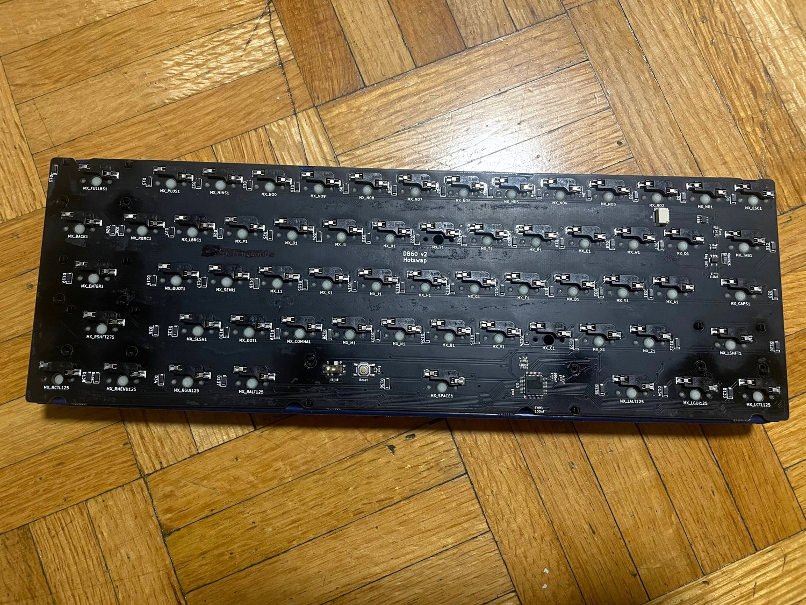
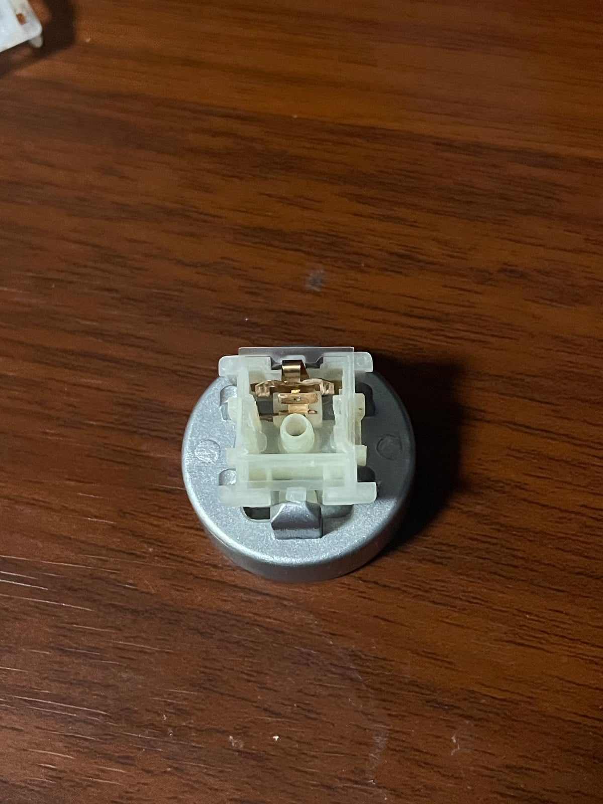
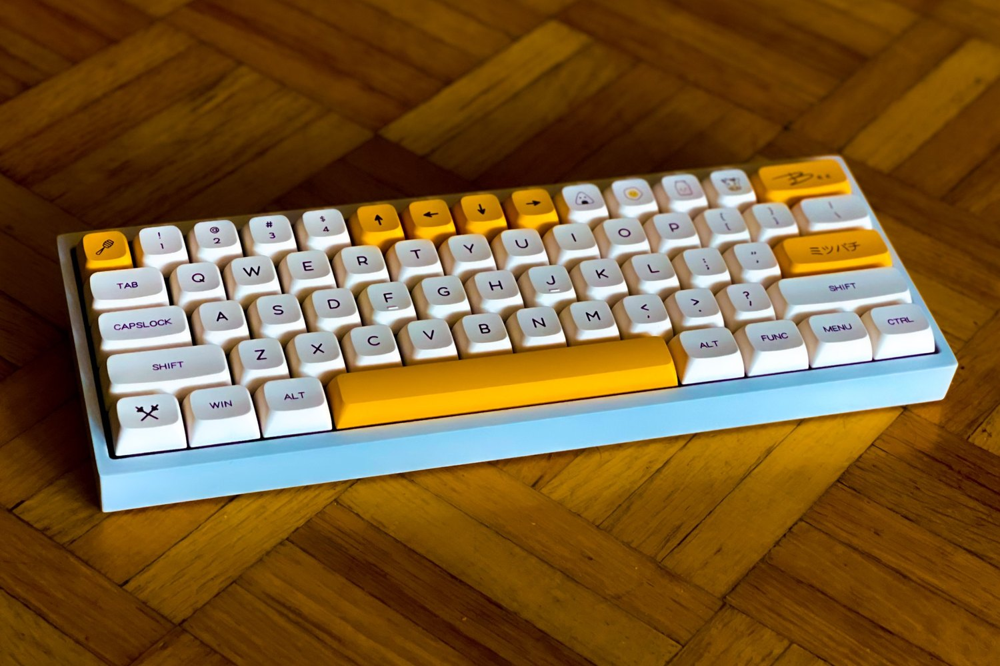

## Overview

I've been building keyboards for people since December 2022. Twenty-two so far. Most clients come to me with a sound or a feel in mind rather than a parts list, and my job is to turn that into a board: the case, the switches, and how everything is mounted.

## Problem / Goal

"I want it to sound deep" or "I want it to feel light" isn't something you can order off a shelf. Every build starts by pinning down what the client actually means, then working backwards to the parts that will get there.

## What I did

- Designed custom cases in Onshape and had them CNC-machined in aluminum through PCBWay.
- Modded switches to match each brief: mixing housings and stems, filming, lubing, and swapping springs.
- Picked the mounting style for each board and built with top mount, O-ring, and gasket mounts.
- Soldered, assembled, and tested every board, and debugged clients' keyboard issues, including reflashing firmware.

## Process

### Case design

I've designed cases for several builds. One example:

**Goal:** a soft, even-feeling board that opens up easily and has room for an optional brass weight.

**How I got there:** I modelled the case in Onshape around an O-ring mount. The plate and PCB sit in a rubber O-ring pressed against the case walls, so no screws go through the plate and every key feels the same. Because the assembly floats, I moved the USB port onto a small daughterboard screwed into its own pocket, wired to the PCB through a milled channel, so plugging in a cable doesn't load the PCB. The brass weight (about three times denser than aluminum) gets a separate pocket with two screws, so it's optional. The case was CNC-machined in aluminum through PCBWay.

### Switches

Stock switches rarely land exactly where a client wants, so I take them apart and rebuild them from parts of different switches. This is one I documented start to finish.

#### Frankenswitch: the Zaku-Y

The Zaku-Y is a Zaku (Tecsee) and a Gateron Milky Yellow combined into one switch.

**Goal:** the deeper, softer sound of the Milky Yellow with the firmer bottom-out and quicker return of the Zaku.

| Part | Zaku | Milky Yellow | Used in the Zaku-Y |
| --- | --- | --- | --- |
| Top housing | Polycarbonate (PC) | Nylon (PA66) | Milky Yellow |
| Bottom housing | Nylon | Nylon (PA66) | Milky Yellow |
| Stem | POM, longer centre pole | POM | Zaku |
| Spring | Stainless, double-stage, 63.5 g bottom-out | Stainless, single-stage, 62 g bottom-out | Zaku |

**Housings: Milky Yellow.** The housing is what rings when the stem hits it, so its material sets the pitch. The Zaku's top is polycarbonate, an amorphous, glassy plastic that is stiff and has little internal damping, so it rings bright. The Milky Yellow's top is PA66 nylon, which is semi-crystalline and absorbs a little moisture, so it damps vibration and sounds lower. I kept both Milky Yellow halves rather than mixing housings, because a matched pair from the same mould fits tighter and wobbles less.

, Zaku polycarbonate on the right.")

**Stem: Zaku.** Both stems are POM, which is slippery and wear-resistant, so either runs smoothly in nylon. The difference is length: the Zaku's longer centre pole bottoms out on the housing slightly earlier, giving shorter travel and a firm, defined stop. In a nylon housing that stop stays low-pitched instead of clacky.

, with the longer pole.")

**Spring: Zaku.** The Zaku's stainless double-stage spring is light at the start of the press, then stiffer near the bottom. The stiffer stage slows the stem before it hits the housing and stores more energy for the return stroke, so the key comes back up faster.

. The tighter coils mark where the rate changes.")

**Film.** A thin film between the housing halves takes up the small gap between them, so the top can't wobble or rattle. A rattling housing sounds hollow and varies from key to key.

**Lube and assembly.** A thin coat of lube on the stem rails and spring smooths the travel and stops spring ping. Then the Zaku spring and stem go into the Milky Yellow bottom, and the Milky Yellow top closes over them.

**Result:** the Milky Yellow's lower, softer sound, with the Zaku's firmer bottom-out and quicker return.

### Mounting

**Goal:** match how the board feels under your fingers to the brief.

**How I get there:** for clients who want something firm and precise, I use a top mount, with the plate screwed straight into the case. For a softer, bouncier board with a more even sound, I use an O-ring or a gasket mount, where the plate floats on rubber or foam strips instead of being bolted down.

### Builds

## Results / Impact

Twenty-two boards since December 2022, from tenkeyless down to 60%, several with custom aluminum cases I designed in CAD. No boards have come back.

## What I learned

Early on I built boards the way I like them: my favourite sound, my favourite feel. That was the wrong reference. The person paying is the one typing on it every day. Now I start from what the client asked for and treat my own taste as a suggestion.

I also learned that no single part makes the sound. The same switches sound different in a top-mount aluminum case and an O-ring case, so I test switches in the actual board before I finish a build.

