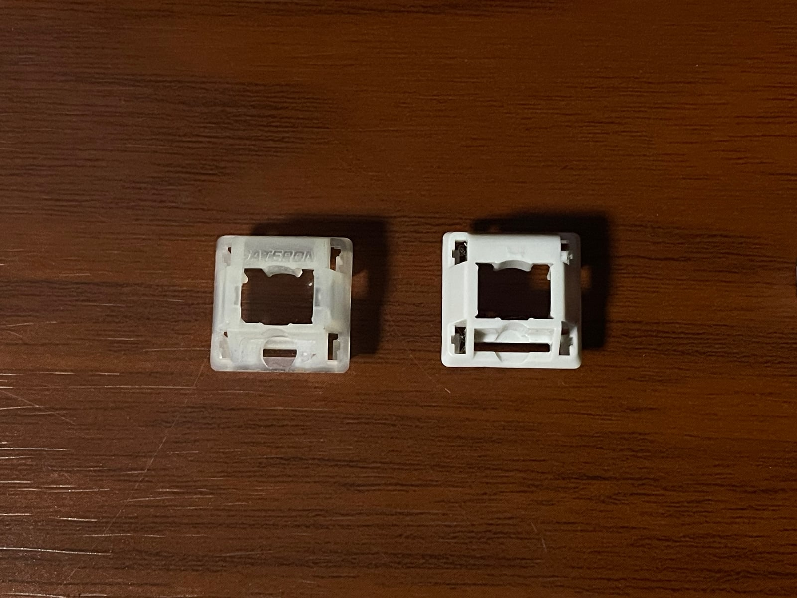
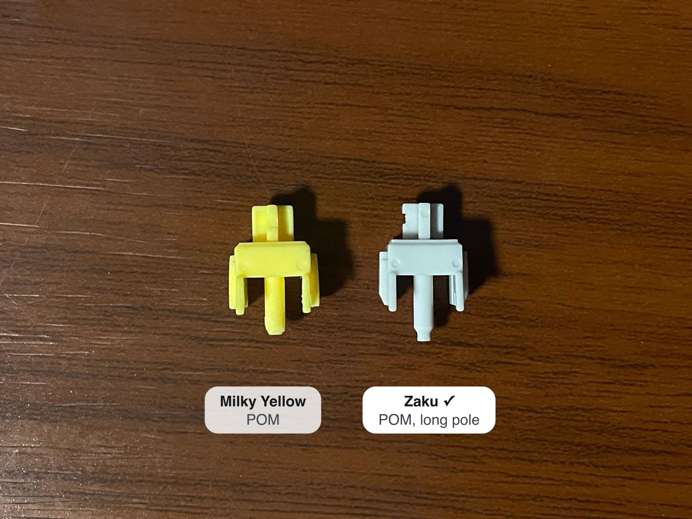
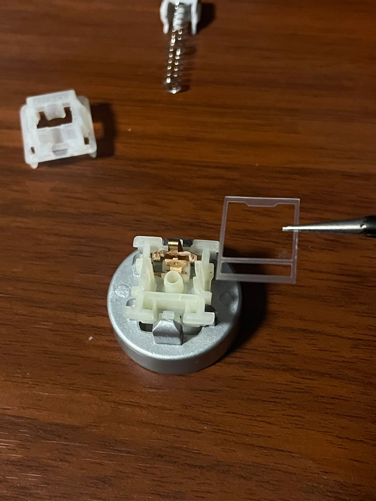
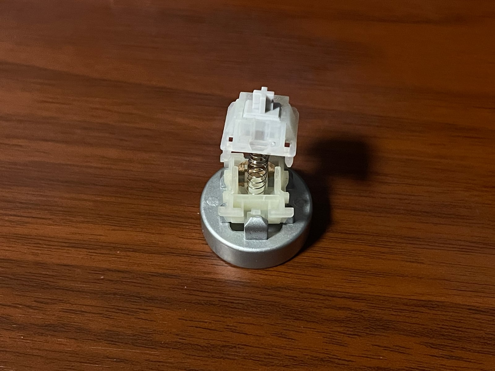
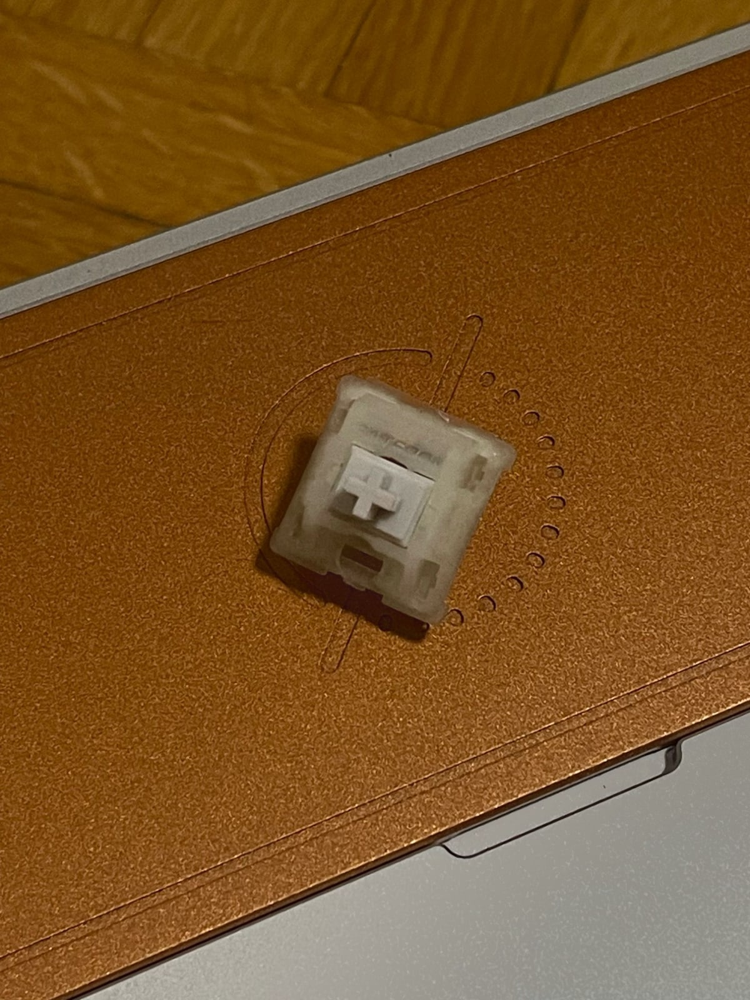

## Overview

I've been building keyboards for people since December 2022. Twenty-two so far. Most clients come to me with a sound or a feel in mind rather than a parts list, and my job is to turn that into a board: the case, the switches, and how everything is mounted.

## The goal

"I want it to sound deep" or "I want it to feel light" isn't something you can order off a shelf. Every build starts by pinning down what the client actually means, then working backwards to the parts that will get there.

## What I did

- Designed custom cases in Onshape and had them CNC-machined in aluminum through PCBWay.
- Modded switches to match each brief: mixing housings and stems, filming, lubing, and swapping springs.
- Picked the mounting style for each board and built with top mount, O-ring, and gasket mounts.
- Soldered, assembled, and tested every board, and debugged clients' keyboard issues, including reflashing firmware.

## Process

### Case design

I've designed cases for several builds. One example, with a soft, even feel and room for an optional brass weight:

- **O-ring mount.** The plate and PCB sit in a rubber O-ring pressed against the case walls. No screws go through the plate, so every key feels the same.
- **USB daughterboard.** Because the assembly floats, the port sits on its own board in a screwed-down pocket, so plugging in a cable doesn't load the PCB.
- **Optional weight.** The brass weight has its own pocket and two screws. The case was CNC-machined in aluminum through PCBWay.

### Switches

Stock switches rarely land exactly where a client wants, so I take them apart and rebuild them from parts of different switches. This is one I documented start to finish.

#### Frankenswitch: the Zaku-Y

**Goal:** the deeper sound of a Gateron Milky Yellow with the firmer, snappier feel of a Zaku.

 slows the stem before it bottoms out and speeds up the return.")

**Result:** the Milky Yellow's lower, softer sound with the Zaku's firmer bottom-out and quicker return.

### Mounting

Top mount (plate screwed straight to the case) for clients who want firm and precise. O-ring or gasket mount (plate floating on rubber or foam) for a softer, bouncier board with a more even sound.

### Builds

## Results

Twenty-two boards since December 2022, from tenkeyless down to 60%, several with custom aluminum cases I designed in CAD. No boards have come back.

## What I learned

Early on I built boards the way I like them: my favourite sound, my favourite feel. That was the wrong reference. The person paying is the one typing on it every day. Now I start from what the client asked for and treat my own taste as a suggestion.

I also learned that no single part makes the sound. The same switches sound different in a top-mount aluminum case and an O-ring case, so I test switches in the actual board before I finish a build.

