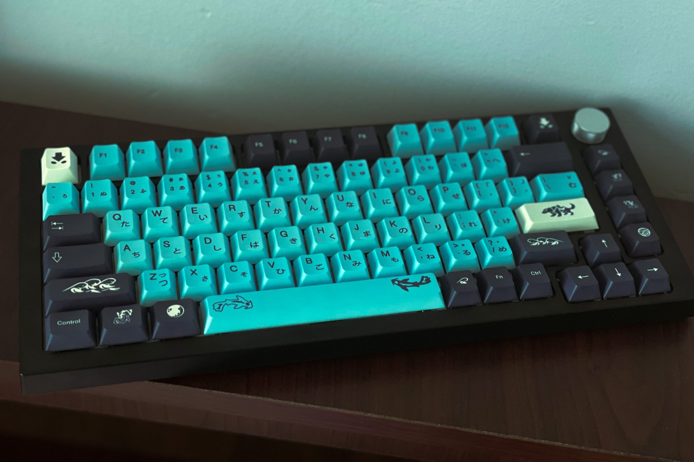

## Overview

I run a small business building custom mechanical keyboards for clients. Each build starts with what the client wants: layout, typing feel, sound, look, and budget. I turn that into a parts specification, then source, modify, and assemble it.

<!-- TODO: add a sentence on how clients find you (word of mouth, Instagram, Reddit, etc.) and any business numbers you're happy to share. -->

## Problem / Goal

Two people can want opposite things from the same layout. The goal of every build is a board that matches one client's brief (feel, sound, look, and budget) and keeps working for years.

## What I did

- **Design.** I design CNC-machined cases in Onshape and write the fabrication specs, then have them CNC-machined through PCBWay.
- **Build.** I modify the switches, solder and assemble each board, and test every key.
- **Fix.** When a board comes back with a dead key or a bad connection, I trace the fault and repair it.

> **Why this way:** Two people can want opposite things from the same layout. Writing the brief down first means every part choice can be checked against what that client asked for.

## Process

### The builds: twenty-two keyboards, each built to a brief

### Case design: an O-ring mounted case, machined in aluminum

I designed this case in Onshape, and it was CNC-machined in aluminum through PCBWay for a client build. The model shows the aluminum body in red and a brass weight in gold. The client commissioned the case without the weight, so the brass part was designed but not made.

**O-ring mount.** A rubber O-ring is stretched around the edge of the plate and PCB assembly, and the assembly is pressed into the case. The O-ring is the only thing touching the case walls, so no screws pass through the plate.

**Daughterboard pocket.** The USB-C port sits on a small separate board that screws into its own pocket in the case and connects to the main PCB by a short cable, which runs in a milled channel.

**Brass weight.** The design has a brass plate fastened into a pocket in the base with two screws. It is an option the client can leave out, as this one did.

> **Why an O-ring:** Rubber between the assembly and the case absorbs vibration, so every key feels and sounds the same instead of being stiffer near screw points. It also lets the assembly lift out by hand for repairs.

> **Why a daughterboard:** The assembly floats on the O-ring, so a port soldered to the main PCB would move against the case opening and take the strain of every cable pull. Fixing the port to the case keeps it aligned, and a damaged port can be replaced without replacing the PCB.

> **Why brass:** Brass is about three times denser than aluminum. The added mass keeps the board planted on the desk and deepens its sound. It also adds cost, which is why it is optional.

## Results / Impact

22 client keyboards built since December 2022, from tenkeyless boards down to 60% layouts, plus a custom aluminum case designed and machined for a client build.

<!-- TODO: add any client feedback, repeat customers, or revenue figures you're comfortable publishing. -->

## What I learned

| Issue | What happened | What I changed |
| --- | --- | --- |
| Building to my taste, not the client's | Early on I made design choices based on how I like a keyboard to feel, sound, and look. That was the wrong reference. The person paying for the board is the one who types on it every day. | I now work from the client's requirements first and treat my own preferences as suggestions. It taught me that a design is only good if it suits the person using it. |
