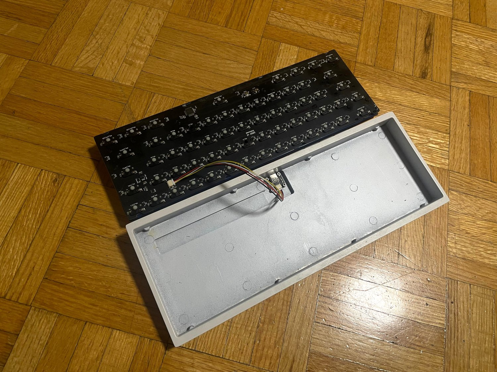
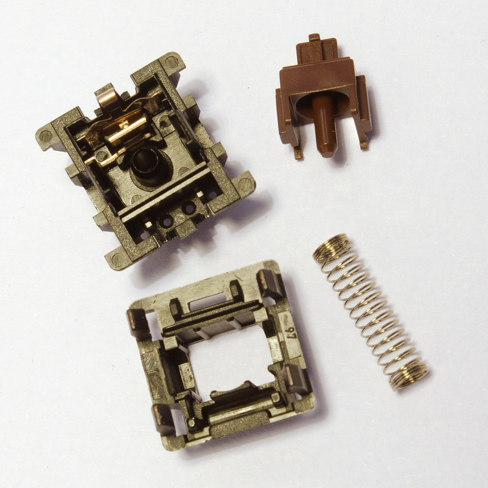
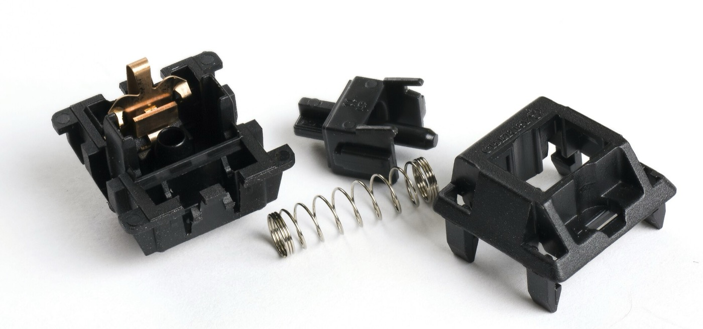
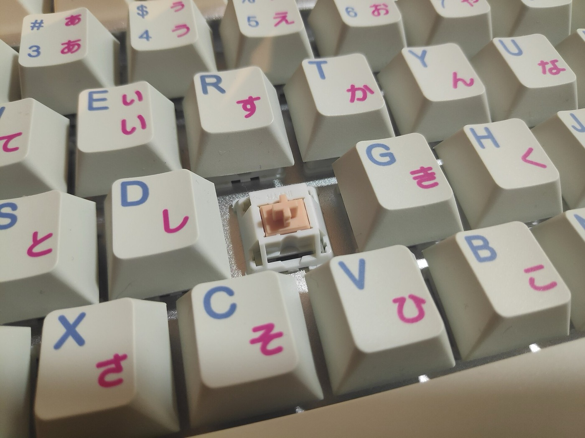
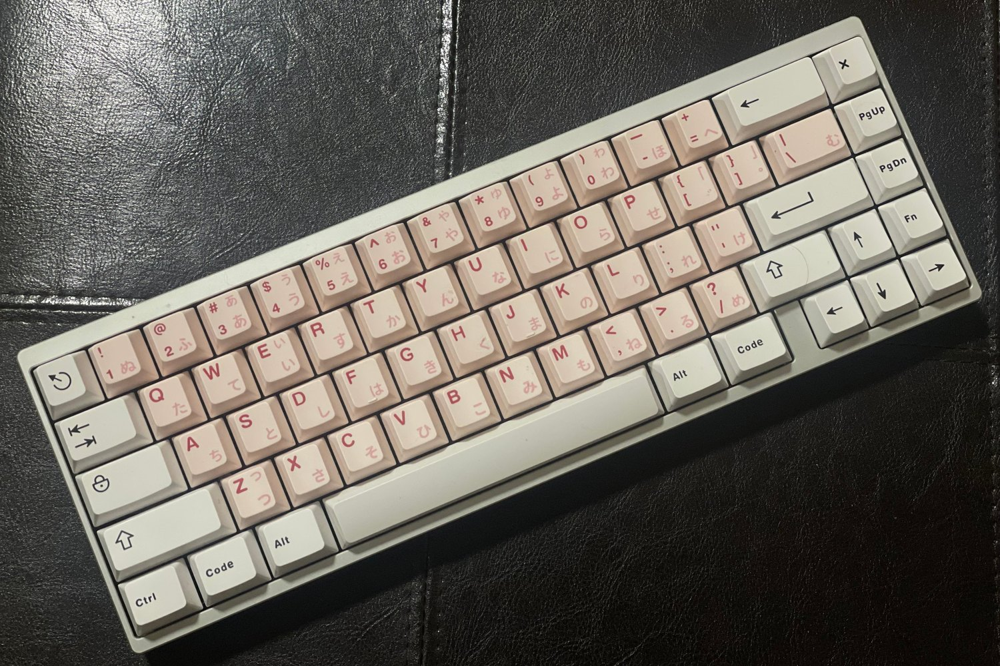

## Overview

I've been building keyboards for people since December 2022. Twenty-two so far. Most clients come to me with a sound or a feel in mind rather than a parts list, and my job is to turn that into a board: the case, the switches, and how everything is mounted.

## Problem / Goal

"I want it to sound deep" or "I want it to feel light" isn't something you can order off a shelf. Every build starts by pinning down what the client actually means, then working backwards to the parts that will get there.

## What I did

- Designed custom cases in Onshape and had them CNC-machined in aluminum through PCBWay.
- Modded switches to match each brief: mixing housings and stems, filming, lubing, and swapping springs.
- Picked the mounting style for each board and built with top mount, O-ring, and gasket mounts.
- Soldered, assembled, and tested every board, and repaired the ones that came back.

## Process

### Case design

**Goal:** a case for a client who wanted a board that felt soft and even, could be opened up for repairs, and had room for an optional brass weight.

**How I got there:** I modelled the case in Onshape around an O-ring mount. The plate and PCB sit in a rubber O-ring that presses against the case walls, so there are no screws through the plate and every key feels the same. That choice drove the rest of the design. Since the whole assembly floats, a USB port soldered to the PCB would move every time a cable was plugged in. So I gave the port its own small daughterboard, screwed into a pocket in the case and wired to the PCB through a milled channel. The brass weight got its own pocket in the base with two screws, so it could be left out. This client did leave it out. The case was machined in aluminum through PCBWay.

### Switches

A switch comes apart into four pieces: a top housing, a bottom housing, a stem, and a spring. A frankenswitch is just a switch put back together from pieces of different switches. The most famous one is the Holy Panda, which is Halo stems dropped into Invyr Panda housings. Nobody sold it, people built it.

Two briefs come up the most:

**Goal: deep and quiet.** **How I get there:** a softer bottom housing to take the edge off each keypress, a smooth stem so nothing scratches, and a thin film between the housings so they don't rattle. Then a light coat of lube on the stem and housing rails, and a spring heavy enough that the bottom-out isn't harsh.

**Goal: a strong, rounded bump.** **How I get there:** this is the Holy Panda idea. A stem with a big tactile leg goes into housings that let the bump come through cleanly. I lube the rails and the spring but never the legs, or the bump goes mushy.

Each time, I build a few test switches, put them in a board, and type on them before committing to a full set of 70 to 90.

### Mounting

**Goal:** match how the board feels under your fingers to the brief.

**How I get there:** for clients who want something firm and precise, I use a top mount, with the plate screwed straight into the case. For a softer, bouncier board with a more even sound, I use an O-ring or a gasket mount, where the plate floats on rubber or foam strips instead of being bolted down.

### Builds

## Results / Impact

Twenty-two boards since December 2022, from tenkeyless down to 60%, plus a custom aluminum case designed and machined for a client.

## What I learned

Early on I built boards the way I like them: my favourite sound, my favourite feel. That was the wrong reference. The person paying is the one typing on it every day. Now I start from what the client asked for and treat my own taste as a suggestion.

I also learned that no single part makes the sound. The same switches sound different in a top-mount aluminum case and an O-ring case, so I test switches in the actual board before I finish a build.

<small>Switch photos from Wikimedia Commons, licensed [CC BY-SA 4.0](https://creativecommons.org/licenses/by-sa/4.0/): [disassembled tactile switch](https://commons.wikimedia.org/wiki/File:Cherry_MX_Brown_switch_(disassembled).jpg) by Multicherry, [opened linear switch](https://commons.wikimedia.org/wiki/File:Cherry_MX_black_opened.jpg) by Dmitriy Nosachev, [Holy Panda](https://commons.wikimedia.org/wiki/File:An_Invyr_Holy_Panda_switch_inside_an_Idobao_ID80_keyboard.jpg) by KazlMatas. All other photos and CAD are my own.</small>
