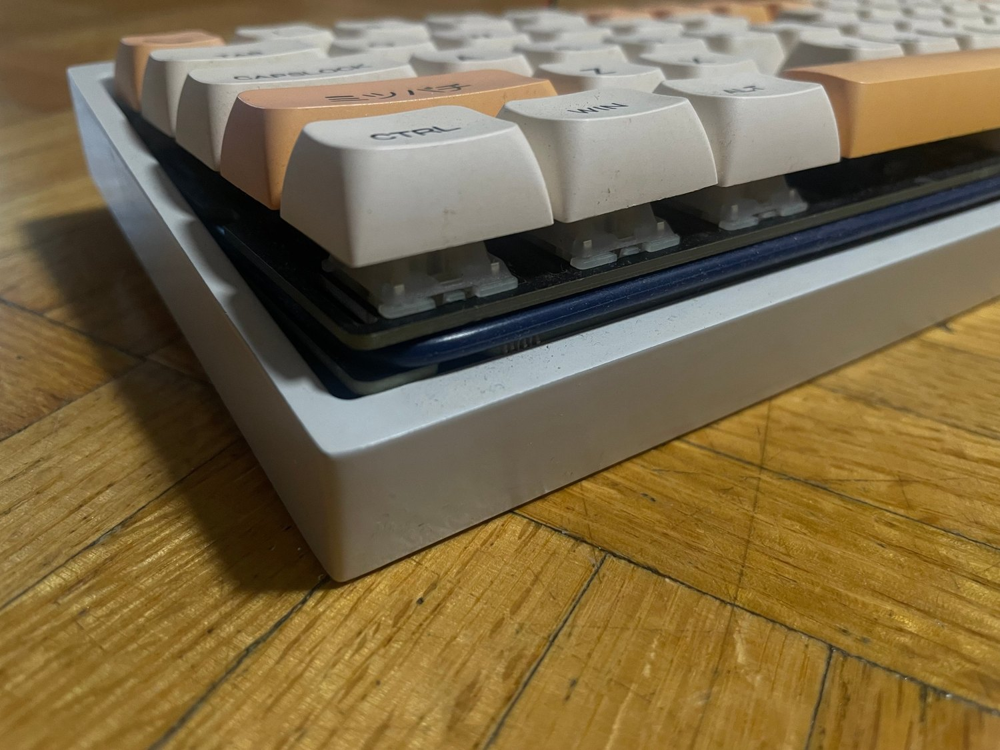
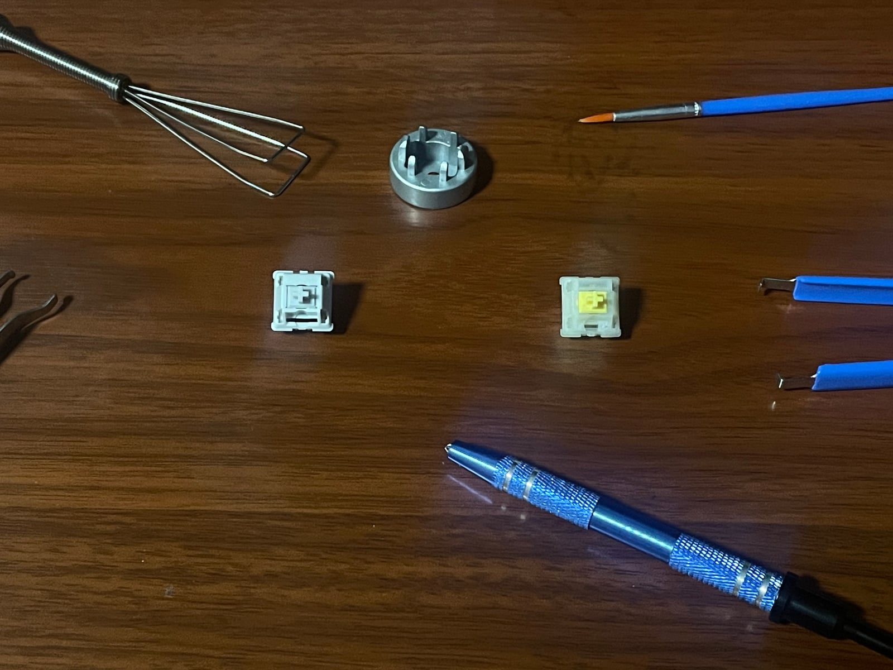
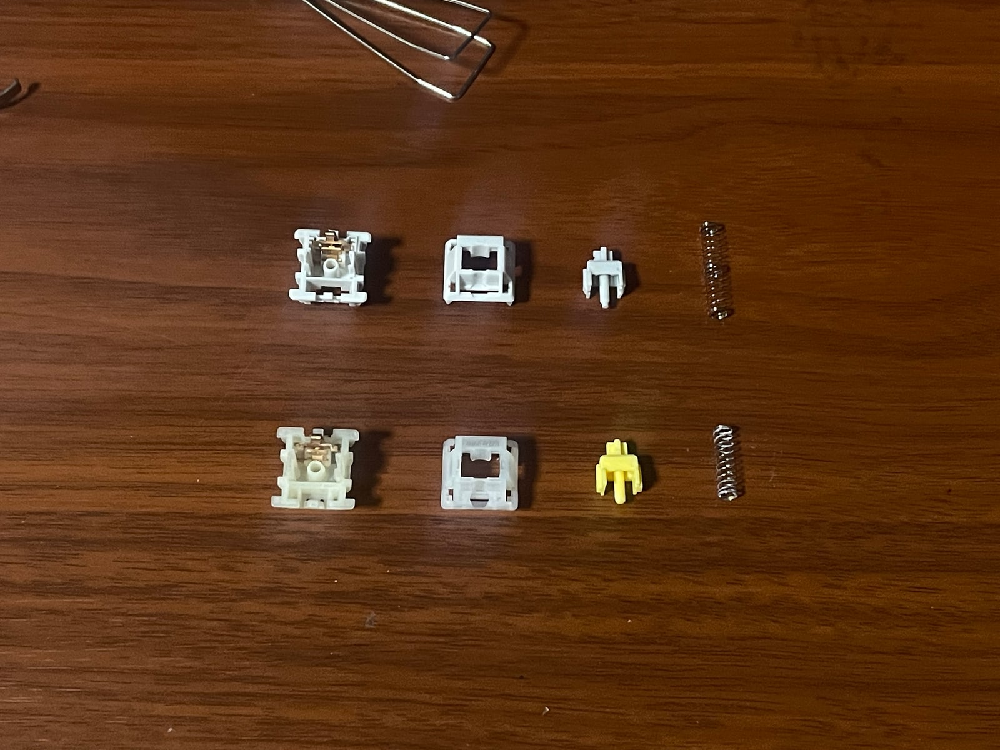
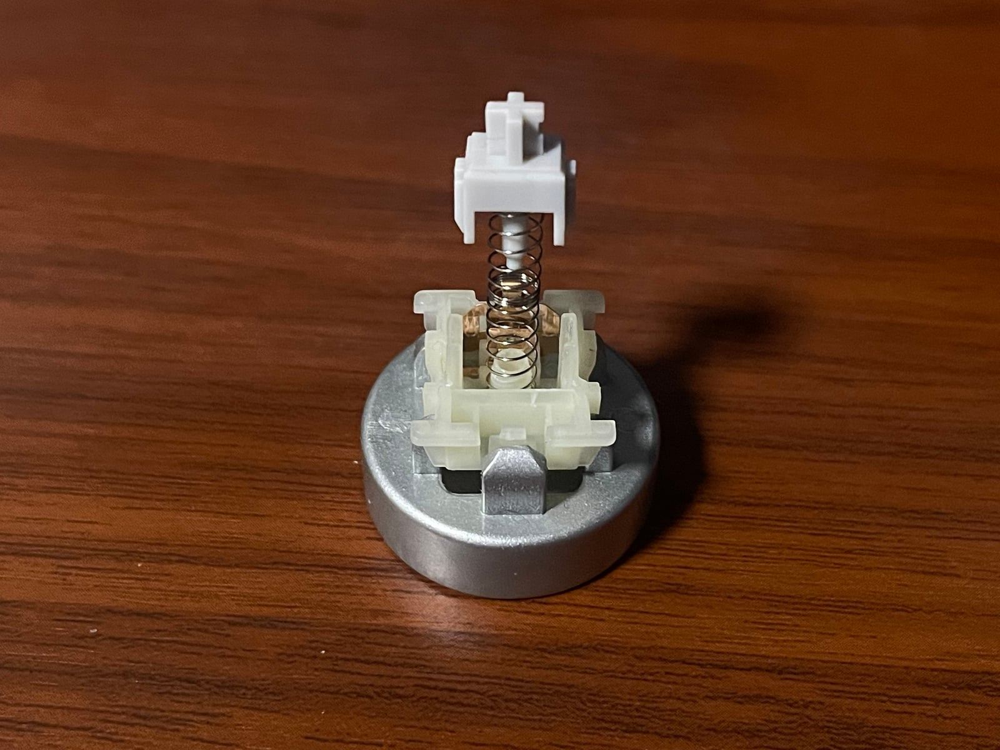
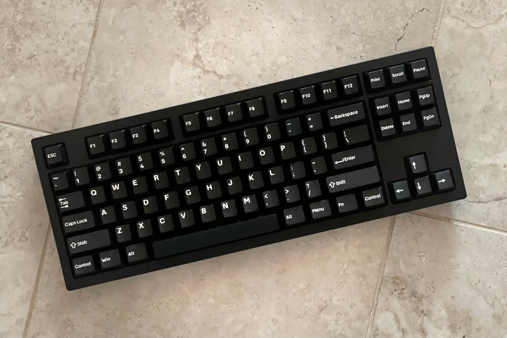

## Overview

I've been building keyboards for people since December 2022. Twenty-two so far. Most clients come to me with a sound or a feel in mind rather than a parts list, and my job is to turn that into a board: the case, the switches, and how everything is mounted.

## Problem / Goal

"I want it to sound deep" or "I want it to feel light" isn't something you can order off a shelf. Every build starts by pinning down what the client actually means, then working backwards to the parts that will get there.

## What I did

- Designed custom cases in Onshape and had them CNC-machined in aluminum through PCBWay.
- Modded switches to match each brief: mixing housings and stems, filming, lubing, and swapping springs.
- Picked the mounting style for each board and built with top mount, O-ring, and gasket mounts.
- Soldered, assembled, and tested every board, and repaired the ones that came back.

## Process

### Case design

**Goal:** a case for a client who wanted a board that felt soft and even, could be opened up for repairs, and had room for an optional brass weight.

**How I got there:** I modelled the case in Onshape around an O-ring mount. The plate and PCB sit in a rubber O-ring that presses against the case walls, so there are no screws through the plate and every key feels the same. That choice drove the rest of the design. Since the whole assembly floats, a USB port soldered to the PCB would move every time a cable was plugged in. So I gave the port its own small daughterboard, screwed into a pocket in the case and wired to the PCB through a milled channel. The brass weight got its own pocket in the base with two screws, so it could be left out. This client did leave it out. The case was machined in aluminum through PCBWay.

### Switches

Stock switches rarely land exactly where a client wants, so I take them apart and rebuild them from parts of different switches. This is one I documented start to finish.

#### Frankenswitch: Zaku × Milky Yellow

**Goal:** a linear that sounds deeper and softer than a stock Zaku, but feels crisper and snappier than a stock Milky Yellow.

Neither switch did both. The Zaku had the feel I wanted and the Milky Yellow had the sound, so I took them both apart and kept the parts that did each job.

**Housings from the Milky Yellow.** When the stem bottoms out or springs back up, it's the housing that rings, so the housing sets most of the pitch. The Milky Yellow's milky housings are a softer, more damped plastic than the Zaku's white ones. That pulls the sound lower and rounds off the clack, which covers the "deeper" half of the goal.

, Zaku on the right.")

**Stem from the Zaku.** The Zaku stem has the longer centre pole. A longer pole hits the bottom housing just before the rest of the stem would, so travel is slightly shorter and the bottom-out is one clean, firm stop instead of a soft landing. That's the "crisper" half. And because it now bottoms out in a Milky Yellow housing, the sound stays low instead of turning clacky.

, with the longer pole.")

**Spring from the Zaku.** The Zaku uses a double-action spring, which has two rates: light for the first part of the press, then stiffer near the bottom. The key starts easy, the extra force slows the stem before it hits bottom so it doesn't slam, and the same stored force pushes the key back up faster. That's where the "snappier" comes from.

. The tighter coils mark where the rate changes.")

**Film.** Parts from two different switches don't always sit perfectly tight, and a loose top housing wobbles and rattles. That rattle is what makes a switch sound hollow and inconsistent from key to key. A thin film between the two housing halves takes up the gap, so the housing behaves like one solid part.

**Lube.** A thin coat on the stem's sliding rails and on the spring. It smooths out the travel and stops the spring pinging, without using so much that the key feels slow to come back up.

**Assembly.** The Zaku spring and stem go into the Milky Yellow bottom housing, then the Milky Yellow top closes over them.

**Result:** the Milky Yellow's lower, softer sound, with the Zaku's firmer bottom-out and quicker return.

### Mounting

**Goal:** match how the board feels under your fingers to the brief.

**How I get there:** for clients who want something firm and precise, I use a top mount, with the plate screwed straight into the case. For a softer, bouncier board with a more even sound, I use an O-ring or a gasket mount, where the plate floats on rubber or foam strips instead of being bolted down.

### Builds

## Results / Impact

Twenty-two boards since December 2022, from tenkeyless down to 60%, plus a custom aluminum case designed and machined for a client.

## What I learned

Early on I built boards the way I like them: my favourite sound, my favourite feel. That was the wrong reference. The person paying is the one typing on it every day. Now I start from what the client asked for and treat my own taste as a suggestion.

I also learned that no single part makes the sound. The same switches sound different in a top-mount aluminum case and an O-ring case, so I test switches in the actual board before I finish a build.

