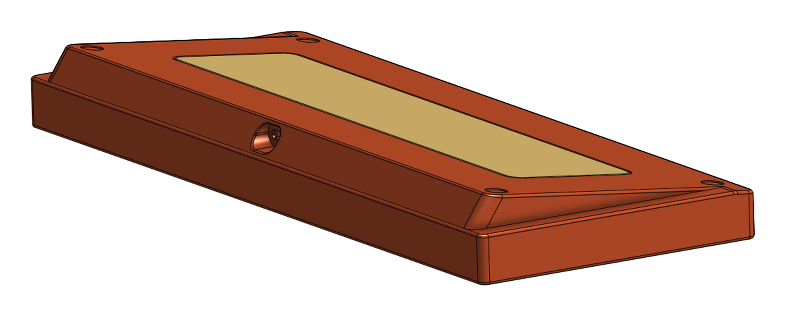
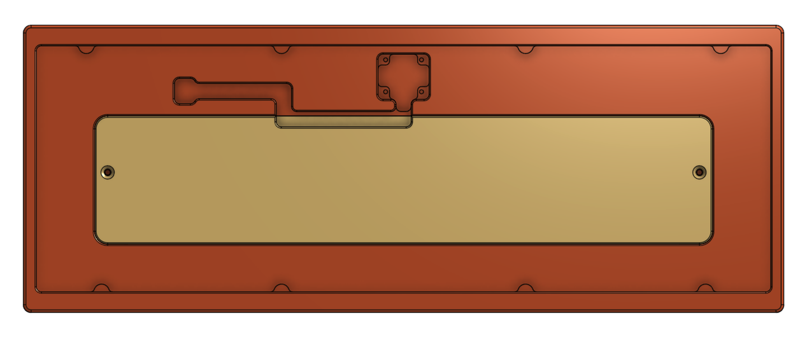

## Overview

I run a small business building custom mechanical keyboards for clients. Each build starts with what the client wants: layout, typing feel, sound, look, and budget. I turn that into a parts specification, then source, modify, and assemble it.

Most of the work is in the switches and the mounting. The same keycaps can sound deep and muted or bright and clacky depending on which plastics the switch is made from, how it's lubricated, what spring is inside, and how the plate is held in the case. I learned the material science behind those choices from the keyboard community's write-ups, and I use it to hit a specific sound and feel for each client.

## Problem / Goal

Two people can want opposite things from the same layout: one wants a deep, quiet "thock", another a crisp, bright "clack"; one wants a light, smooth linear, another a sharp tactile bump. The goal of every build is a board that matches one client's brief and keeps working for years.

## What I did

- **Switches.** I frankenswitch, film, lube, and re-spring switches to reach the target sound and feel.
- **Design.** I design CNC-machined cases in Onshape, write the fabrication specs, and have them machined through PCBWay.
- **Build.** I solder and assemble each board, choose the mounting style and foam, and test every key.
- **Fix.** When a board comes back with a dead key or a bad connection, I trace the fault and repair it.

> **Why this way:** Writing the brief down first means every part choice, from housing plastic to foam, can be checked against what that client asked for.

## Process

### Switch materials: why the plastic changes the sound

An MX-style switch has three plastic parts: a top housing, a bottom housing, and the stem that slides between them. When a key bottoms out or springs back, the stem strikes the housing, and the housing rings at frequencies set by its stiffness, density, and internal damping. Changing the polymer changes that ring.

| Polymer | Structure | Typical effect |
| --- | --- | --- |
| **Polycarbonate (PC)** | Amorphous and very stiff, with low internal damping. It's clear because there are no crystallites to scatter light. | Vibrations ring longer and higher, giving a brighter, crisper "clack". Common for top housings. |
| **Nylon (PA66)** | Semi-crystalline, with polar amide groups that hydrogen-bond. It absorbs a little moisture, which softens it. | More damping, giving a deeper, rounder, more muted sound. Common for bottom housings. |
| **POM (acetal)** | Highly crystalline, dense, and slippery: it's naturally low-friction. | A very smooth stem material. In housings, a deep, full sound and a smooth slide. |
| **PE / PP (polyolefins, such as UHMWPE)** | Long, non-polar hydrocarbon chains with low surface energy, so very little sticks to them. | A waxy, "self-lubricated" smoothness. PE stems and housings often give a soft, creamy, "marbly" sound. |

The useful part is mixing them. A **frankenswitch** takes the top housing from one switch, the bottom from another, and the stem from a third. A PC top over a nylon bottom keeps some brightness on the upstroke but a deeper bottom-out. A POM or PE stem in tight housings is about as smooth as a switch gets. I keep a stock of housings and stems sorted by material and maker, so I can try combinations until the sound matches the brief.

Material isn't everything. Stem-to-housing tolerances, spring, plate, mount, and foam all change the result, so I treat the polymer as the starting point and tune from there.

### Films and lube

**Switch films** are thin sheets, about 0.1–0.15 mm, placed between the top and bottom housing. They take up the slop that lets the housing halves rattle, so the switch wobbles less and sounds tighter and fuller.

**Lube** reduces friction and damps vibration, but the right lube depends on the switch:

- **Linears:** a thin, even coat of Krytox 205g0 on the stem's sliding rails and the housing rails. 205g0 is a perfluoropolyether (PFPE) oil thickened with PTFE. Because it's fully fluorinated it's chemically inert, so it won't attack or craze the plastics. Grade 0 is a soft, thin grease, which is why it smooths scratch without making the switch sluggish.
- **Tactiles:** thinner lubes, such as Tribosys 3203 or 3204, and never on the tactile legs or the leaf. A thick grease there damps the bump the client paid for.
- **Springs:** bag-lubed in a thin oil (a PFPE oil with no thickener, such as Krytox 105) to kill spring "ping" and crunch without changing the weight.
- **Stabilizers:** a heavier dielectric grease on the wire ends, so the spacebar and other long keys don't rattle.

The amount matters as much as the type: too little leaves scratch, and too much turns a switch mushy and slow to return.

### Springs and stems

- **Spring weight** sets how hard you press: a light spring for fast typing, a heavier one for a firmer bottom-out.
- **Long springs** (around 20–22 mm instead of the usual 15 mm) are pre-compressed more inside the housing. The force stays more even through the press and the key returns more snappily.
- **Progressive springs** ramp up toward the bottom, which softens the bottom-out.
- **Two-stage (double-action) springs** are light at the top and get noticeably heavier partway down, giving a "two-step" feel.
- **Long-pole vs. short-pole stems.** A long-pole stem bottoms out on its own pole against the bottom housing before the stem legs do. Travel is shorter and the bottom-out is a sharper, higher "clack". A standard stem gives full travel and a rounder sound.

### Builds

### Mounting: top, gasket, and O-ring

How the plate and PCB are held in the case changes both feel and sound. I've built all three of these:

- **Top mount.** The plate is screwed directly to the top case. It's firm, direct, and consistent, and suits clients who want a stiff, precise board. The trade-off is that keys near the screw points feel stiffer and more vibration reaches the case.
- **Gasket mount.** The plate is sandwiched between strips of PORON or silicone, so it floats with some flex. It's softer, and the case resonates less.
- **O-ring mount.** A rubber O-ring wraps the plate-and-PCB assembly, which is pressed into the case. Nothing is screwed through the plate, so every key feels and sounds the same. The rubber absorbs vibration, which gives a softer, bouncier feel and more muted, even acoustics than top mount. The catch is that an O-ring compressed too tightly stops isolating, so it has to be sized to the case.

### Foam

Foam fills the empty spaces in the case that would otherwise echo:

- **Case foam** (often PORON, a polyurethane) in the bottom of the case absorbs hollowness and the "ping" from metal cases.
- **Plate foam** between the plate and PCB damps plate flex and ringing.
- **PE / IXPE switch pads** are a thin, firm layer of closed-cell polyethylene between the PCB and the switches. They change how the switches couple to the board and give a creamier, "poppier" sound, especially on linears.

Each layer takes away some of the high frequencies and hollow ring. Used together and tuned to the client, they get a board from "tinny" to "full".

### Case design: an O-ring mounted case, machined in aluminum

I designed this case in Onshape, and it was CNC-machined in aluminum through PCBWay for a client build. The model shows the aluminum body in red and a brass weight in gold. The client commissioned the case without the weight, so the brass part was designed but not made.

**Daughterboard pocket.** The USB-C port sits on a small separate board that screws into its own pocket in the case and connects to the main PCB by a short cable, which runs in a milled channel.

**Brass weight.** A brass plate fastens into a pocket in the base with two screws. It's an option the client can leave out, as this one did.

> **Why a daughterboard:** The assembly floats on the O-ring, so a port soldered to the main PCB would move against the case opening and take the strain of every cable pull. Fixing the port to the case keeps it aligned, and a damaged port can be replaced without replacing the PCB.

> **Why brass:** Brass is about three times denser than aluminum. The added mass keeps the board planted on the desk and deepens its sound. It also adds cost, which is why it's optional.

## Results / Impact

22 client keyboards built since December 2022, from tenkeyless boards down to 60% layouts, each with switches, mounting, and foam chosen for that client. One was a custom aluminum case designed and machined for a client build.

## What I learned

| Issue | What happened | What I changed |
| --- | --- | --- |
| Building to my taste, not the client's | Early on I made design choices based on how I like a keyboard to feel, sound, and look. That was the wrong reference. The person paying for the board is the one who types on it every day. | I now work from the client's requirements first and treat my own preferences as suggestions. A design is only good if it suits the person using it. |
| Material isn't the whole sound | It's tempting to pick a housing plastic and expect a sound. The same switch sounds different in a top-mount aluminum case and an O-ring case with foam. | I tune the switch, mount, and foam together, and test in the actual case before finishing a build. |

## Further reading

The community write-ups I learned from and used to check this page:

- [Overview of popular switch housing materials](https://kineticlabs.com/blog/overview-of-popular-mechanical-keyboard-switch-housing-materials) (Kinetic Labs)
- [Plastic is not equally plastic: switch housings](https://www.digitec.ch/en/page/keycap-kevin-plastic-is-not-equally-plastic-that-also-applies-to-switch-housings-26510) (Digitec)
- [How to use Krytox 205 grade 0](https://kineticlabs.com/blog/how-to-use-krytox-205-grade-0) and [lubing tactile switches](https://kineticlabs.com/blog/lubing-tactile-keyboard-switch-guide-how-to) (Kinetic Labs)
- [Introduction to keyboard switch springs](https://kineticlabs.com/blog/introduction-to-keyboard-switch-springs) (Kinetic Labs)
- [Gasket mount vs. top mount](https://mkbguide.com/blog/gasket-mount-vs-top-mount-keyboard) (MKB Guide)
