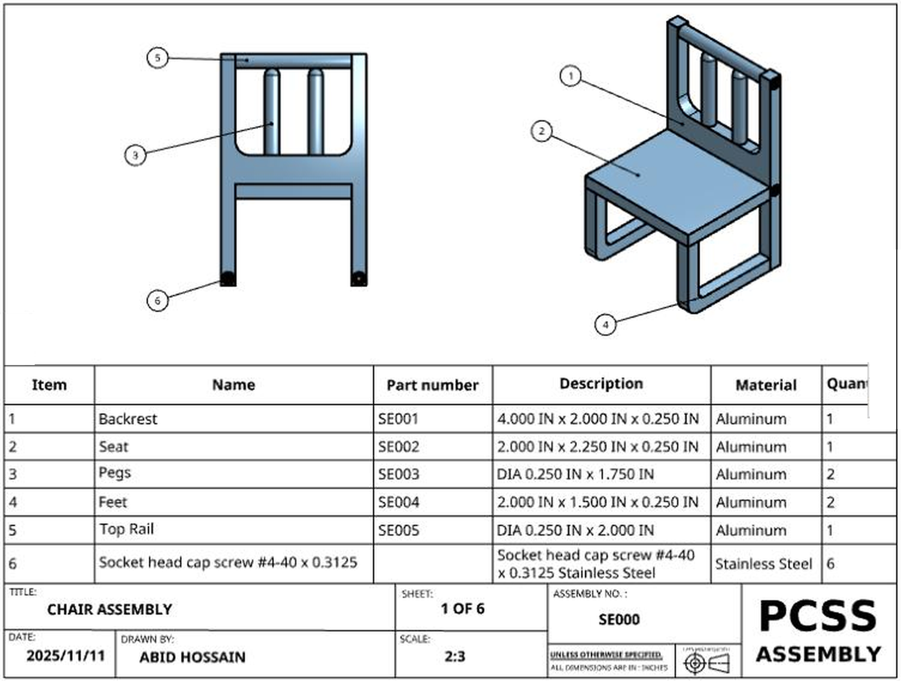
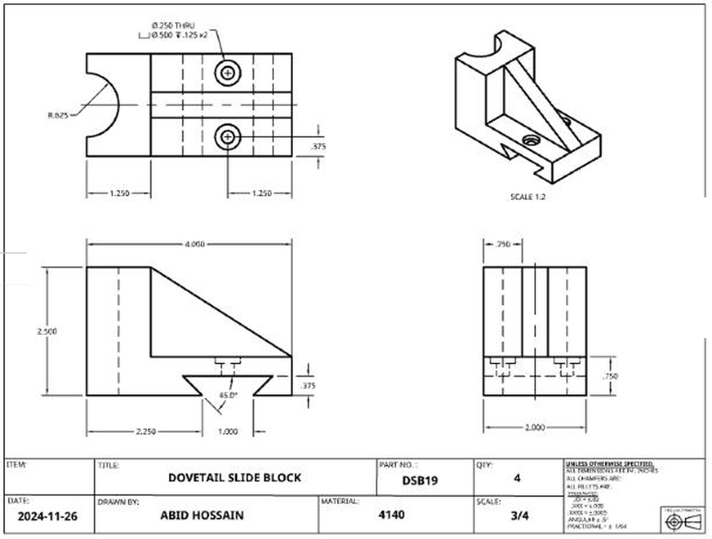
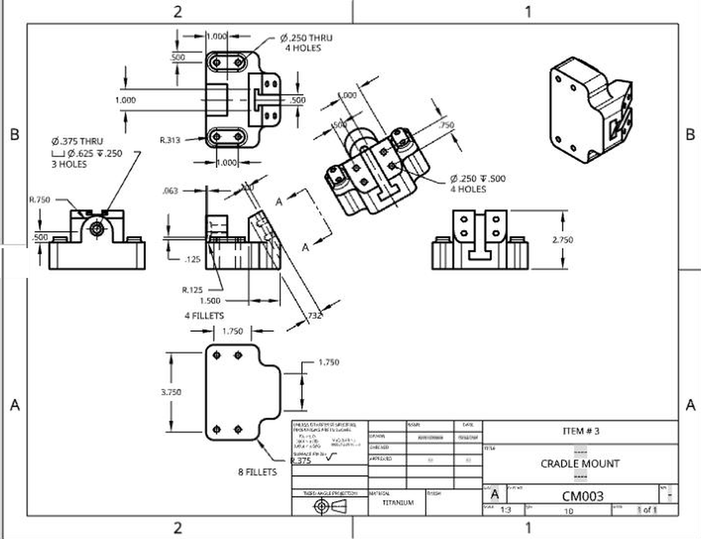
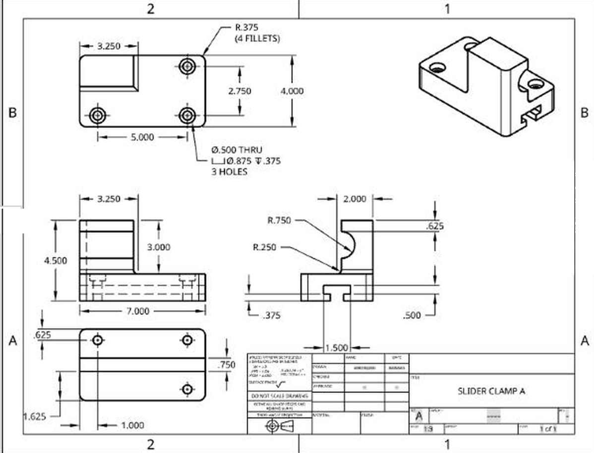
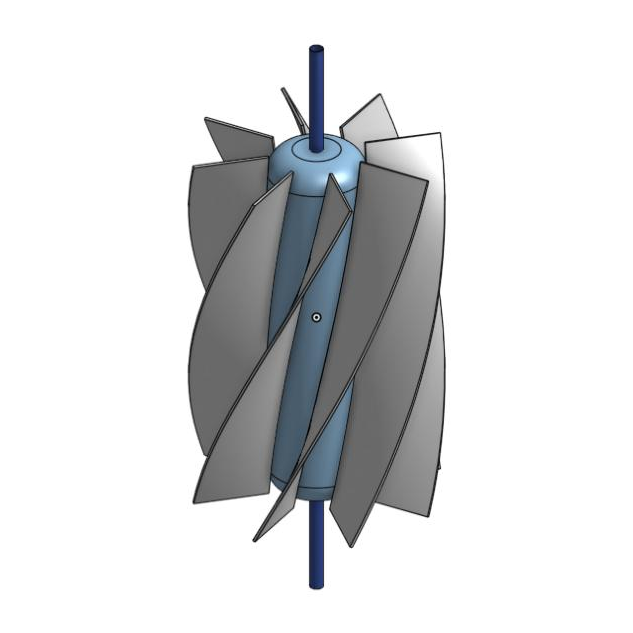
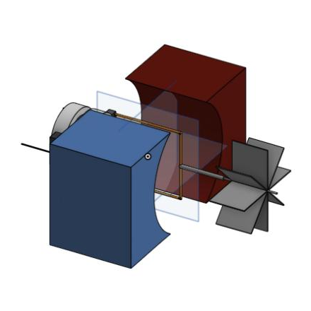

## Overview

In the shop I worked from my own drawings, so each one had to carry everything needed to make the part: views, dimensions, hole and thread callouts, tolerances, and material. Alongside them, I build CAD models on my own to learn new features.

## Problem / Goal

Produce drawings complete enough to machine from without asking questions, even when the machinist is me.

## What I did

- Drew 12+ fully dimensioned parts and assemblies in Onshape and AutoCAD between 2023 and 2026.
- Machined every one of those parts from its drawing.
- Modelled self-directed projects to learn sweeps, helices, patterns, and multi-part assemblies.

## Process

### Drawing first, then the shop

- **Chair assembly.** A six-part aluminum chair held with #4-40 stainless screws. I designed it, produced a six-sheet package with an exploded view, bill of materials, and part numbers, and then machined it.
- **Dovetail slide block.** Orthographic views with a 45° dovetail, counterbored holes, and a tolerance block, in 4140 steel.
- **Cradle mount.** Uses auxiliary and section views, because the angled faces cannot be dimensioned from the standard three.
- **Slider clamp.** Slot, counterbore, and thread callouts on a clamping part.

### Self-directed CAD: models built to learn a feature

- **Helical wind turbine.** I modelled one blade by sweeping a profile along a helix, thickened it, and repeated it with a circular pattern. Building one blade and patterning it means a change to the blade updates all of them.
- **AC generator.** A twelve-part model for a physics project showing the magnets, the rotating coil, and the drive shaft, built to explain how rotation in a magnetic field produces alternating current.

## Results / Impact

Every part was machined from its drawing, including the six-part chair assembly, the pen and pen box, and the tic-tac-toe board.

## What I learned

> A drawing is the contract between design and manufacturing. If a dimension is missing, the machinist has to guess, even when the machinist is me.
