## Overview

Three years of shop work with one rule: nothing gets cut until it's modelled in CAD and has a full drawing. Every part here was drawn in Onshape, then machined from that drawing on a manual lathe, a manual mill, or a CNC mill programmed in Mastercam.

## The goal

Drawings complete enough to machine from without asking questions, and parts that fit each other the first time.

## What I did

- Modelled every part in Onshape and checked fits in an assembly before cutting.
- Drew each part in inches, with thread, hole, and chamfer callouts and a tolerance block.
- Turned, drilled, tapped, and threaded on the lathe; pocketed, drilled, and countersunk on the mill.
- Programmed the CNC engraving on the box lid in Mastercam.

## Process

### 1. Pen: three turned parts and a standard refill

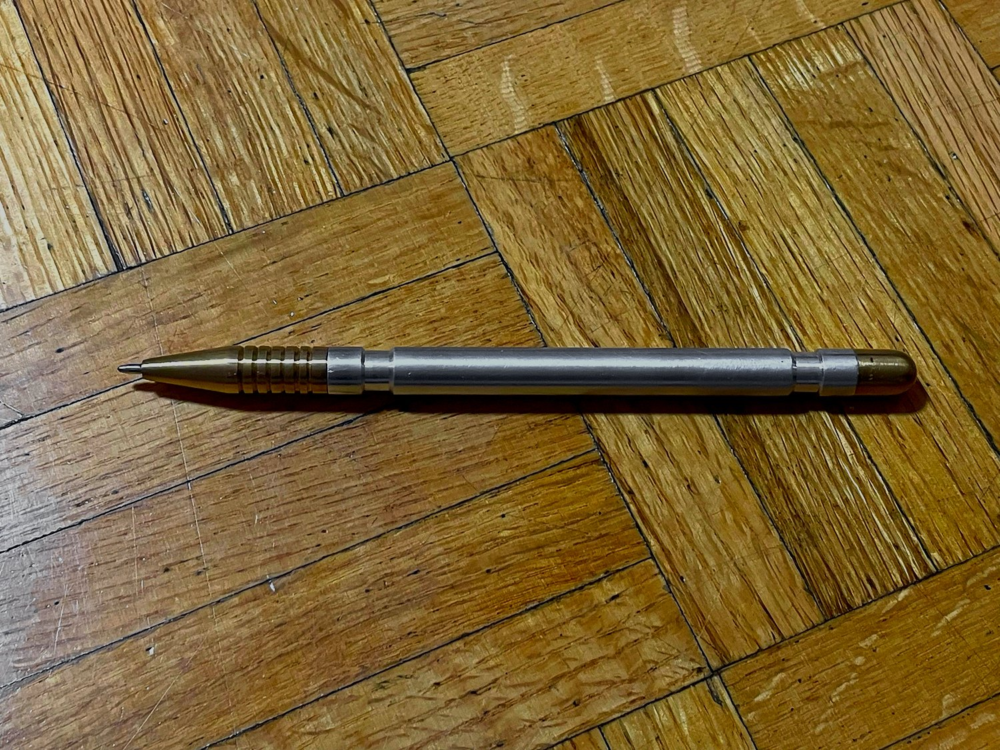
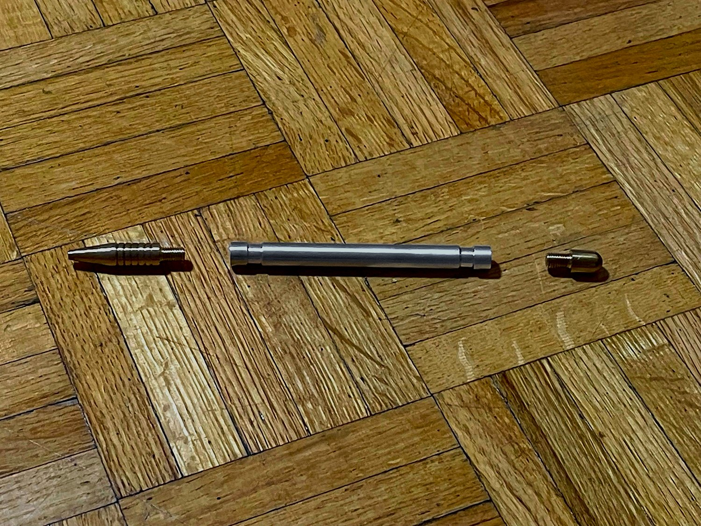

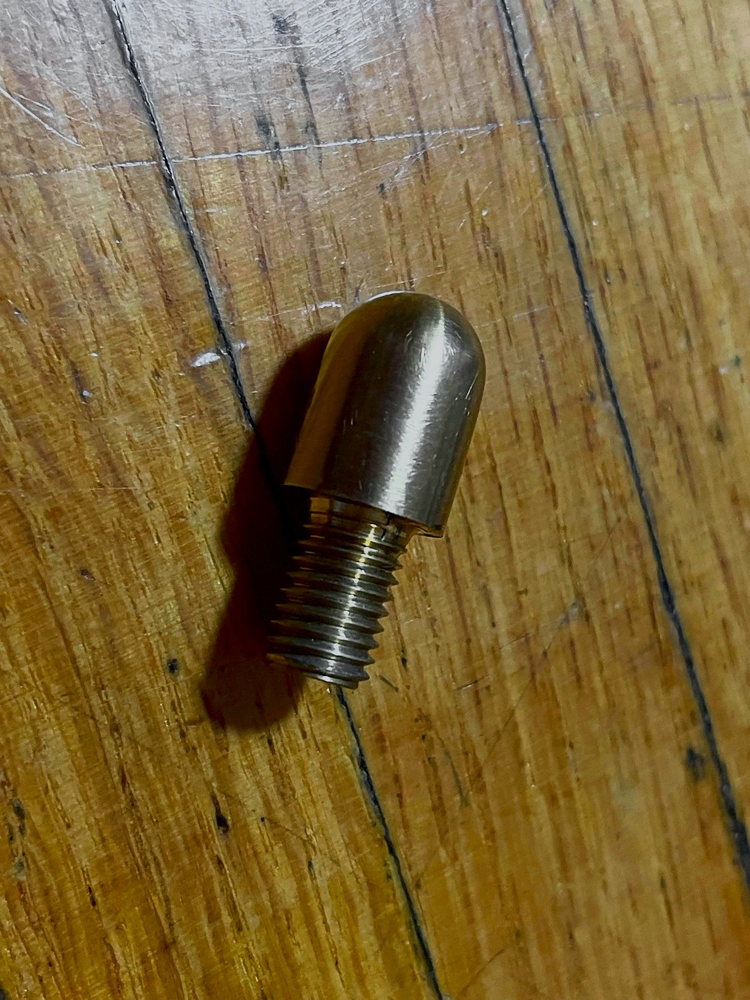
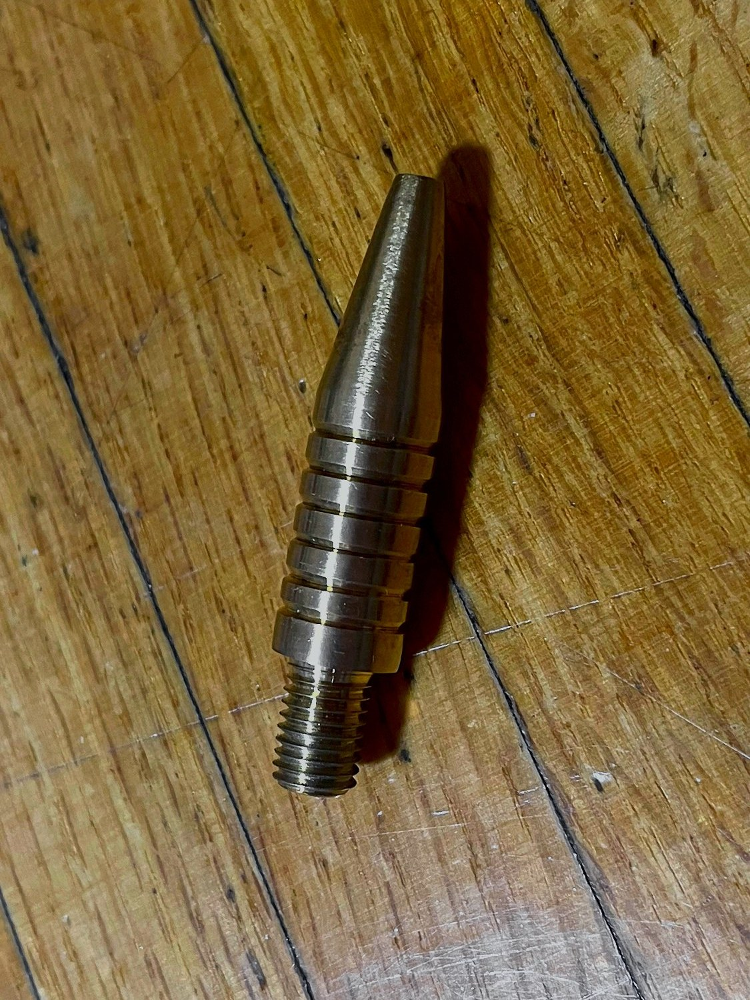

- **Threads.** The barrel is tapped at both ends; the tip and cap have matching external threads.
- **Chamfered mouths** so the brass threads start cleanly instead of cross-threading.
- **Relief grooves** mark the joint to the brass and break up the plain cylinder.

> **What made it hard:** three parts have to share one axis. If a tapped hole is off-centre, the tip sits crooked, so the drawing calls for both ends to be tapped from the spindle.

.")
.")

### 2. Pen box: a milled case with a built-in hinge

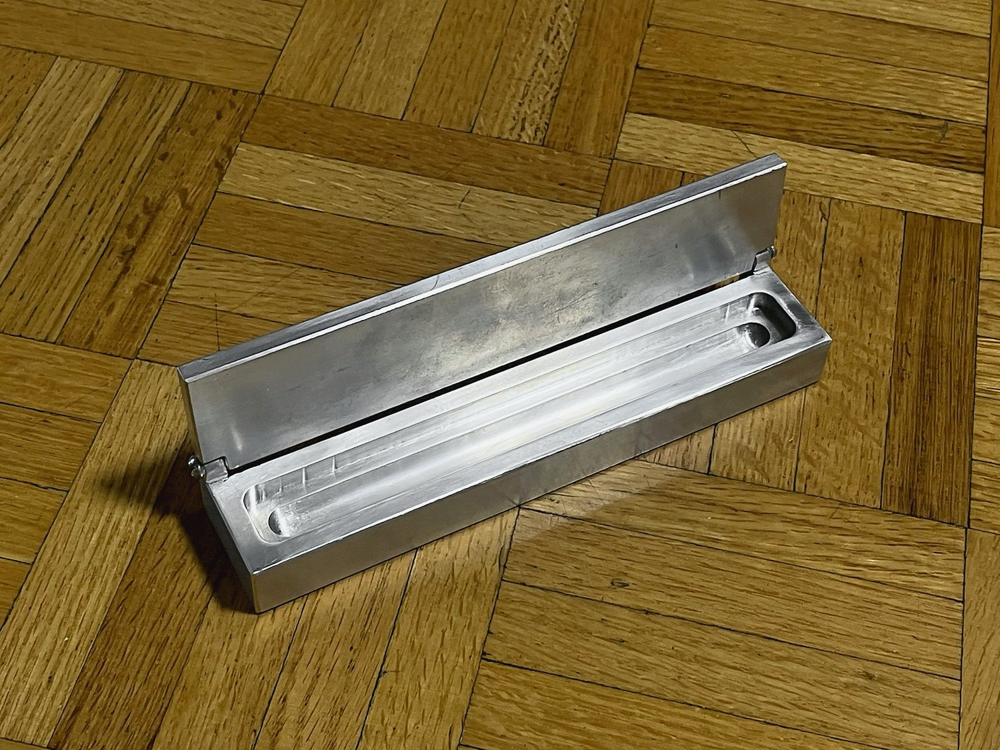

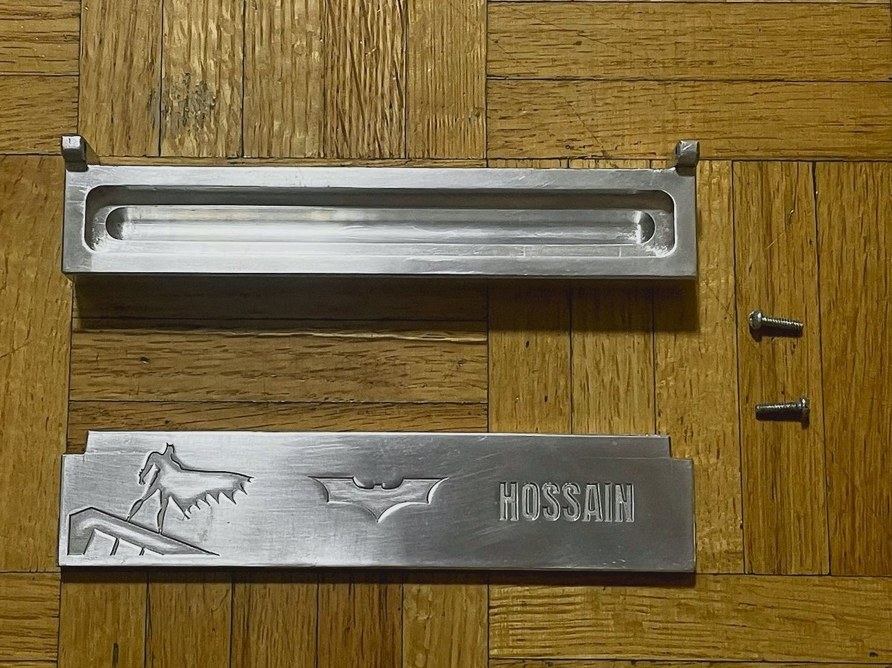

- **Built-in hinge.** Two posts left standing on the base take a screw each as a hinge pin, so there's no separate hinge hardware.
- **Notched lid** clears the posts and closes flush with the base.
- **Rounded inside corners** at the cutter radius, so there's nowhere for dirt to collect.

> **What made it hard:** the hinge only works if both screw holes share one axis and the lid notches match the posts. That's where the ±0.005 in tolerance mattered most, so both drawings dimension the hinge axis from the same back edge.

.")

### 3. Tic-tac-toe: two metals so the players can be told apart

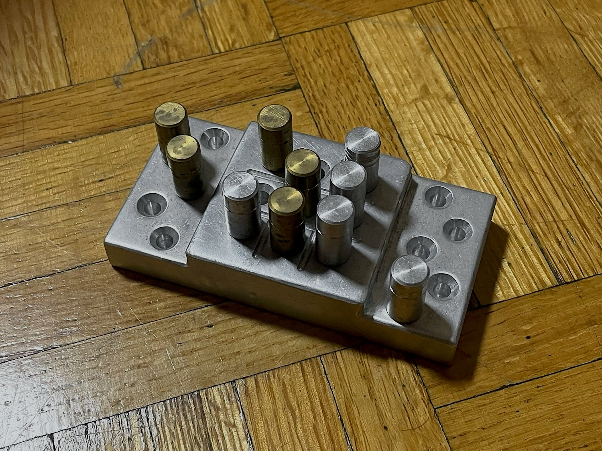
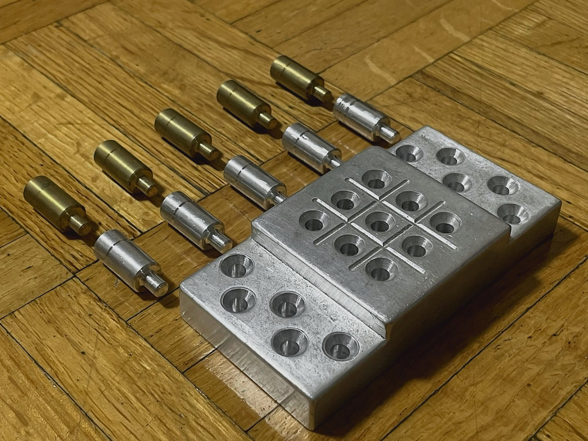

My first project where parts had to fit each other.

- **Pegs** are turned with a shoulder and a locating pin, so they stand upright in a hole.
- **Countersunk holes** guide a peg in even when it's dropped off-centre.
- **Milled grid grooves**, so the lines can't wear off.

> **What made it hard:** any of ten pegs has to fit any of nineteen holes. That only works if every hole and every pin is held to one size, which is why the drawings give a single size for each.

.")
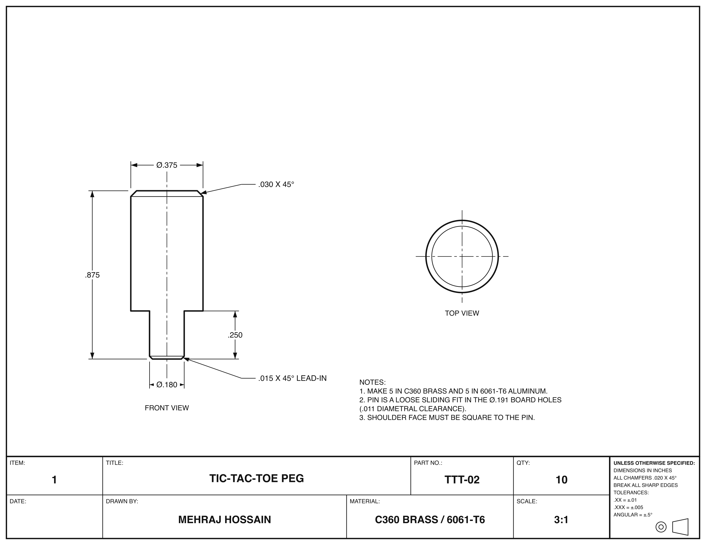

### More drawings and CAD

, and machined it.")

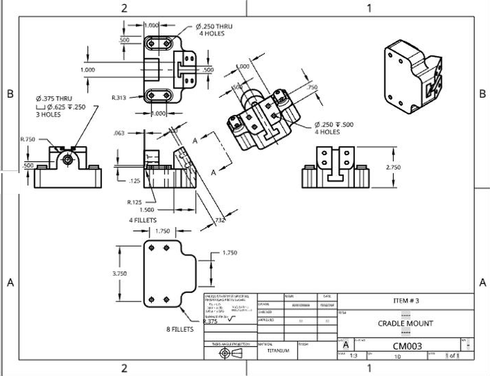
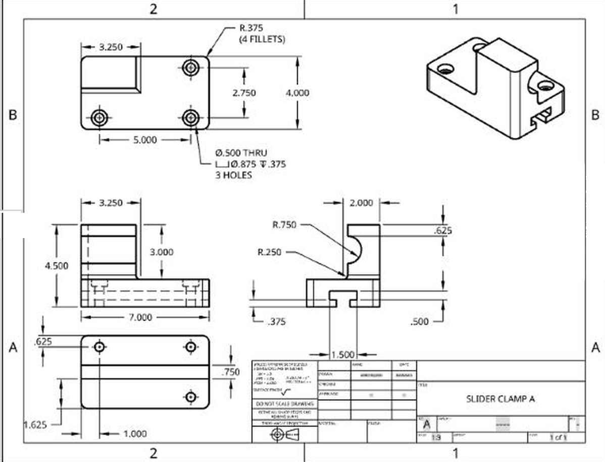

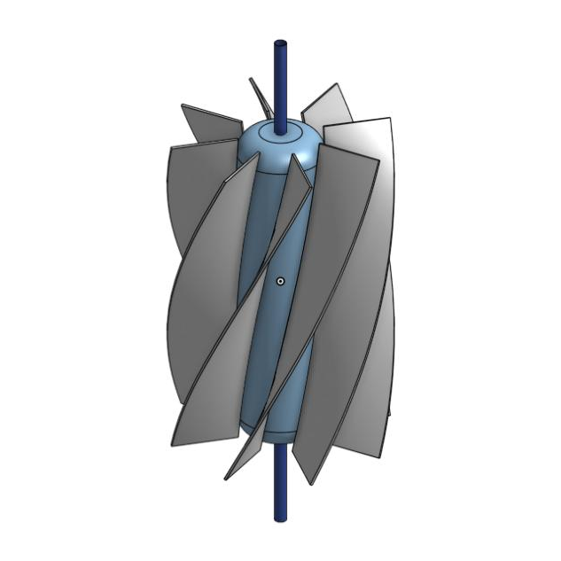
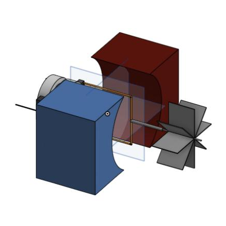

## Results

Every part was machined from its drawing. The pen comes apart for refills, the box lid swings on its built-in hinge and sits flush, and any peg fits any hole. Five things didn't come out the way I drew them, listed below.

## What I learned

Most of what I know about tolerances came from a part not matching its drawing, and working out why.

| Defect | What happened | Next time |
| --- | --- | --- |
| Refill sticks out too far | I drilled the tip's refill bore past its target depth. | Set the quill stop, drill short, and test-fit before final depth. |
| Hinge screws bind | The tap didn't run true, so the threads came out tight and off-axis. | Spot drill, confirm the tap drill size, and guide the tap from the spindle. |
| Rough box pocket | Heat built up at the cutter, so the finish needed a lot of hand polishing. | Cutting fluid, lighter passes, and a shallow finishing pass. |
| Notch in the board corner | I turned a handwheel the wrong way and the cutter nicked a corner. | Check direction with the cutter clear, and set table stops on finishing passes. |
| Uneven board chamfers | Filed by hand at an inconsistent angle, so the edges came out rounded. | Cut chamfers on the mill with a chamfer tool. |
