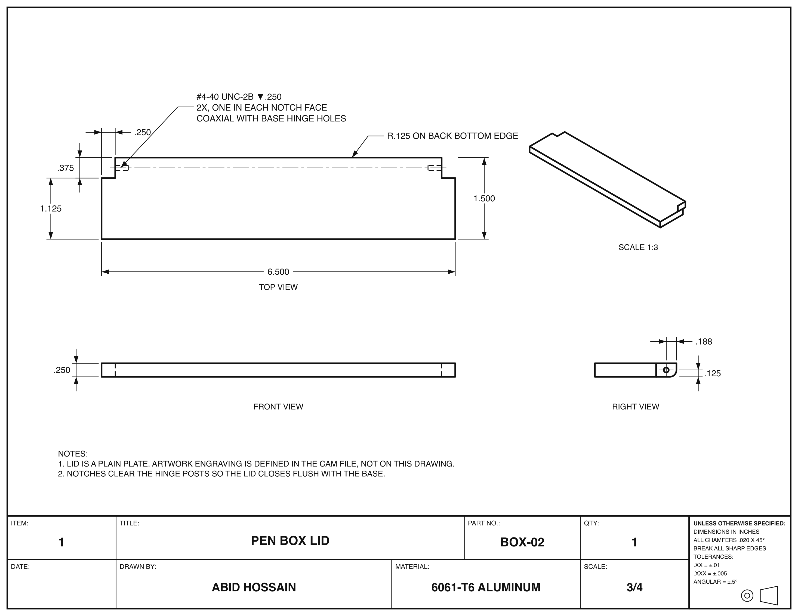
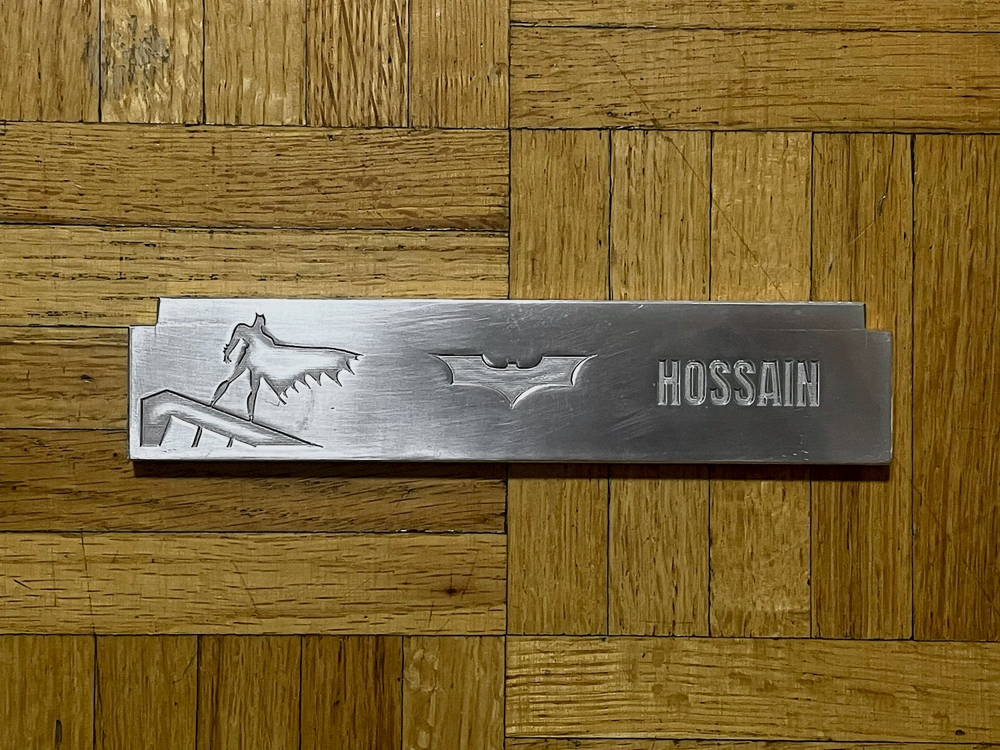
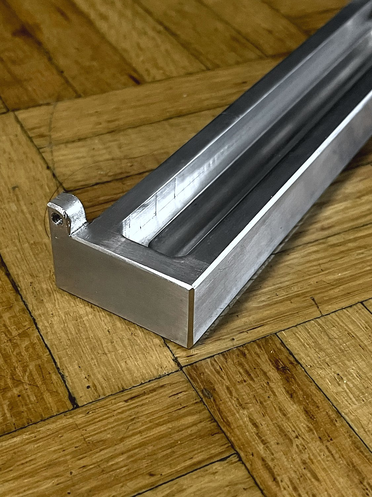
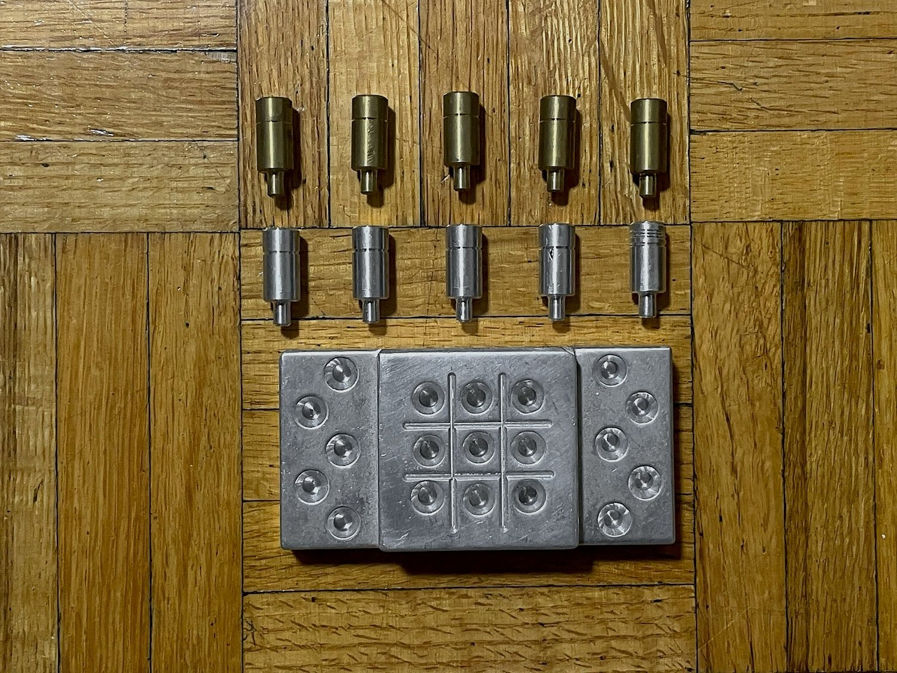
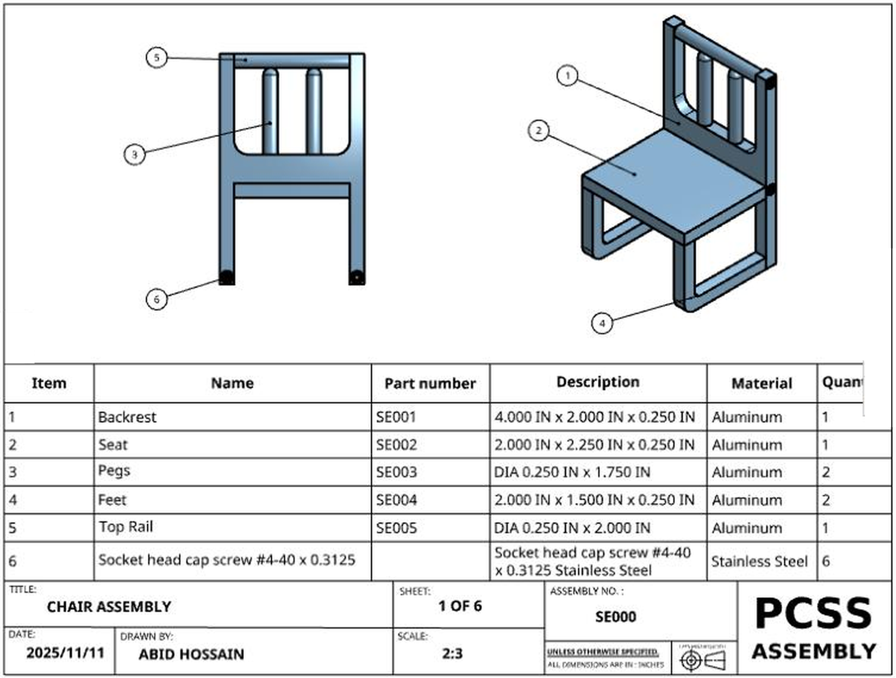
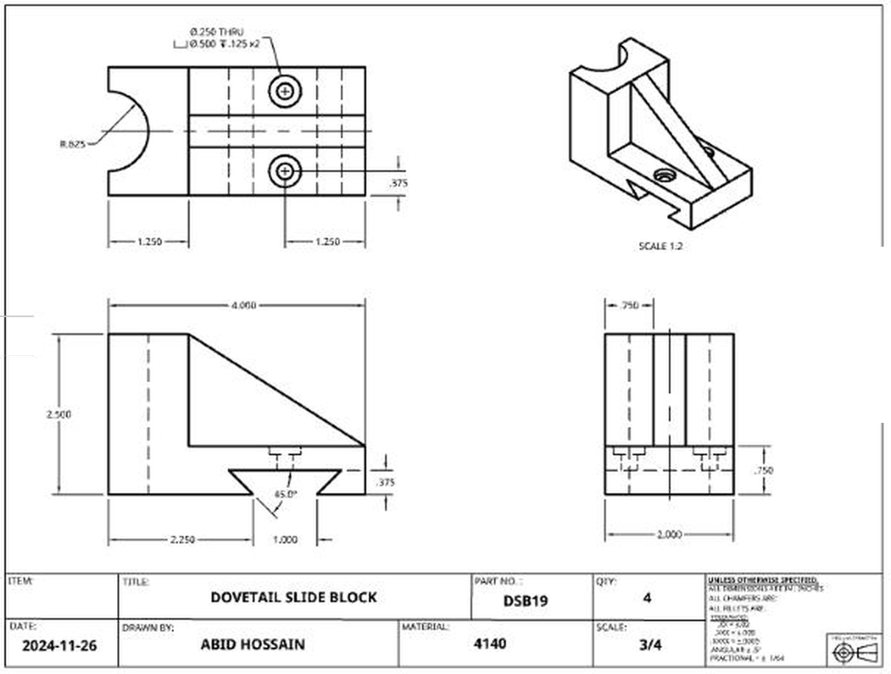

## Overview

Three years of shop work, and the same rule every time: nothing gets cut until it's modelled in CAD and has a full drawing. Every part on this page, from a pen to a six-part chair, was modelled in Onshape, drawn with views, dimensions, callouts, tolerances, and material, and then machined from that drawing on the manual lathe, the manual mill, or a CNC mill programmed in Mastercam.

This page covers three builds in detail (a pen, its box, and a tic-tac-toe set), then the rest of the drawings and some self-directed CAD.

## Problem / Goal

A drawing is the contract between design and manufacturing. If a dimension is missing, the machinist has to guess, even when the machinist is me. The goal was drawings complete enough to machine from without asking questions, and parts that fit each other the first time.

## What I did

- Modelled every part in Onshape and checked the fits in an assembly before making anything.
- Produced a dimensioned drawing for each part, in inches, with thread, hole, and chamfer callouts and a tolerance block.
- Machined each part from its drawing: turning, drilling, tapping, and threading on the lathe, plus pocketing, drilling, and countersinking on the mill.
- Programmed the CNC engraving on the pen box lid in Mastercam.

## Process

### 1. Machined pen: three turned parts and a standard refill

The pen is an aluminum barrel with a brass tip and a brass end cap, all turned on the manual lathe. The barrel is drilled through and tapped at both ends. The tip and cap have matching external threads cut on their shanks.

- **Threaded ends.** Both brass parts unscrew, so the refill can be replaced and the pen comes fully apart.
- **Grip grooves.** Grooves turned into the tip give the fingers something to hold on a polished part.
- **Chamfered mouths.** The barrel openings are chamfered so the brass threads start cleanly instead of cross-threading.
- **Taper and dome.** The tip tapers to the refill point and the cap is rounded, so nothing sharp sits at either end.
- **Relief grooves.** The stepped necks near each end of the barrel mark the transition to the brass and break up the plain cylinder.

> **What made it hard:** The threads on three separate parts have to line up on one axis. If the tapped holes are off-centre, the tip and cap sit crooked and the joint shows. The drawing calls for both ends to be tapped from the spindle for exactly that reason.

.")
.")

### 2. Pen box: a milled case with a built-in hinge

The base and lid are each milled from solid aluminum. The base has a two-level pocket: a wide recess, and inside it a narrower slot sized to the pen so it cannot roll. The slot ends and pocket corners are rounded to the cutter radius, which also leaves no sharp inside corner to collect dirt.

- **Hinge.** Two posts are left standing on the back corners of the base. A machine screw through each post acts as a hinge pin, so the box needs no separate hinge hardware.
- **Rounded posts.** The tops of the posts are filleted. A square corner would catch the lid as it swings; the radius gives it room to rotate freely.
- **Lid.** The lid is notched at both ends to clear the posts, so it closes flush with the base instead of resting on top of them.
- **Engraving.** The lid artwork and my name were programmed in Mastercam and cut on the CNC mill.
- **Edges.** Outside edges are chamfered so the box is comfortable to handle.

> **What made it hard:** The hinge only works if the two screw holes share one axis and the lid notches match the posts. That fit is where the ±0.005 in tolerance mattered most, so the drawings dimension the hinge axis from the same back edge on both parts.

.")

### 3. Tic-tac-toe board: two metals so the players can be told apart

This was my first project that needed parts to fit each other. The board is one aluminum block with a raised playing field and a lower tray at each end.

- **Pegs.** Five brass and five aluminum pegs replace X and O. Each is turned with a shoulder and a locating pin, so it drops into a hole and stands upright.
- **Holes.** All nineteen holes are countersunk. The cone guides a peg in even when it's dropped off-centre, and removes the sharp edge.
- **Clearance.** The pins are a loose sliding fit in the holes, so a peg lifts out with two fingers and never jams.
- **Trays.** Each end tray stores one player's five pegs, so the set stays together.
- **Grid.** The lines are milled grooves, so they won't wear off.

> **What made it hard:** Ten pegs have to fit nineteen holes in any combination. That's only possible if every pin diameter and every hole is held to the same size, which is why the drawings give one hole size for all nineteen and one pin size for all ten pegs.

.")

### More drawings

- **Chair assembly.** A six-part aluminum chair held with #4-40 stainless screws. I designed it, produced a six-sheet package with an exploded view, bill of materials, and part numbers, and then machined it.
- **Dovetail slide block.** Orthographic views with a 45° dovetail, counterbored holes, and a tolerance block, in 4140 steel.
- **Cradle mount.** Uses auxiliary and section views, because the angled faces can't be dimensioned from the standard three.
- **Slider clamp.** Slot, counterbore, and thread callouts on a clamping part.

### Self-directed CAD: models built to learn a feature

- **Helical wind turbine.** I modelled one blade by sweeping a profile along a helix, thickened it, and repeated it with a circular pattern. Building one blade and patterning it means a change to the blade updates all of them.
- **AC generator.** A twelve-part model for a physics project showing the magnets, the rotating coil, and the drive shaft, built to explain how rotation in a magnetic field produces alternating current.

## Results / Impact

Every part was machined from its drawing. The pen comes apart for refills, the box opens and closes on its built-in hinge with the lid sitting flush, and any peg fits any hole on the board. A few things didn't come out the way I drew them, listed below.

## What I learned

> A drawing is the contract between design and manufacturing. Most of what I know about tolerances came from a part not matching its drawing, and working out why.

| Defect | What happened | Next time |
| --- | --- | --- |
| Pen refill protrudes too far | I drilled the refill bore in the tip past its target depth. The refill seats further forward than designed, so the writing point sticks out more than it should. | Set the depth with the quill stop, drill short, and test-fit the refill before taking the bore to final depth. |
| Box hinge screws bind | The tapped holes in the box came out tight. The tap drill and tap didn't run true to the hole axis, so the threads are undersized and slightly off-axis, and the screws are stiff to drive. | Spot drill first, confirm the tap drill size, and guide the tap from the spindle so it starts square. |
| Rough box pocket | Heat built up at the cutter while milling the pocket, and the surface finish suffered. That added a lot of hand sanding and polishing. | Use cutting fluid, clear chips more often, take lighter passes, and leave a shallow finishing pass at the end. |
| Notch in the board corner | I turned a handwheel the wrong way during a milling pass, and the cutter took a small notch out of one corner of the board. | Check the direction of travel with the cutter clear of the part before engaging, and set table stops on finishing passes. |
| Uneven board chamfers | I cut the chamfers by hand with a file, with the board held in a vise. I didn't keep the file at a constant angle, so the edges came out rounded instead of flat and crisp. | Cut the chamfers on the mill with a chamfer tool so every edge has the same angle and width. |
