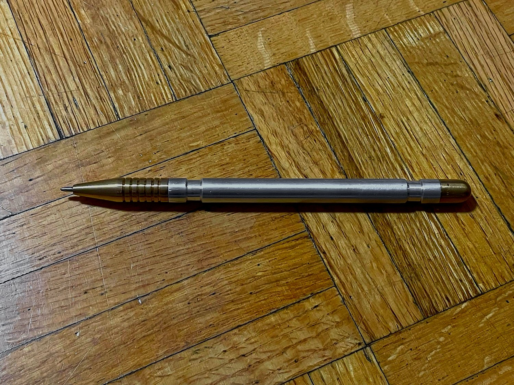
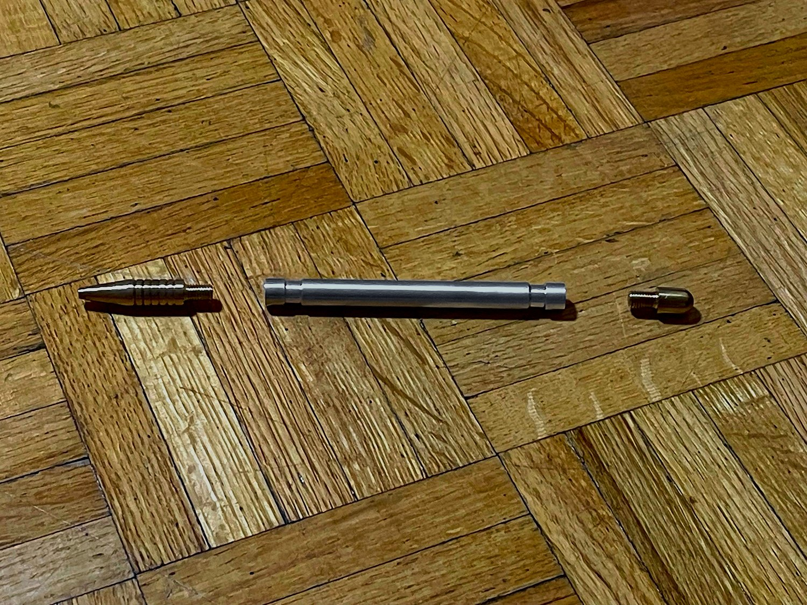
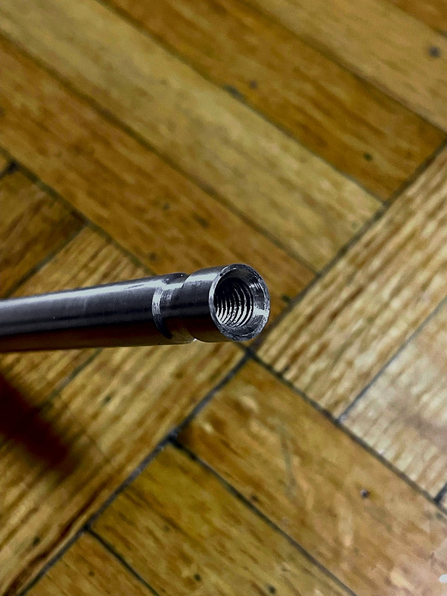
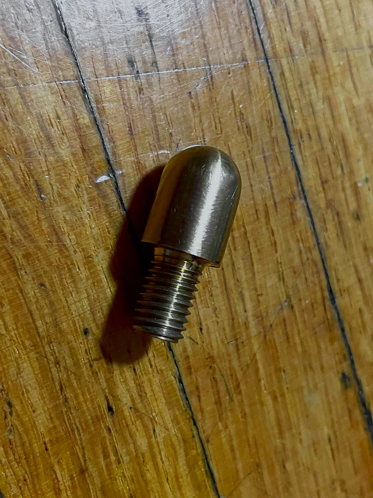
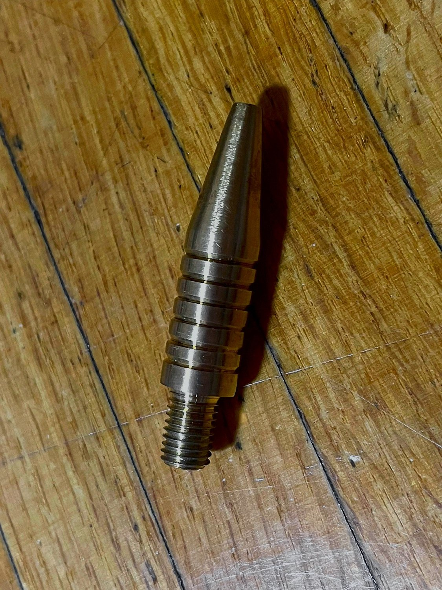
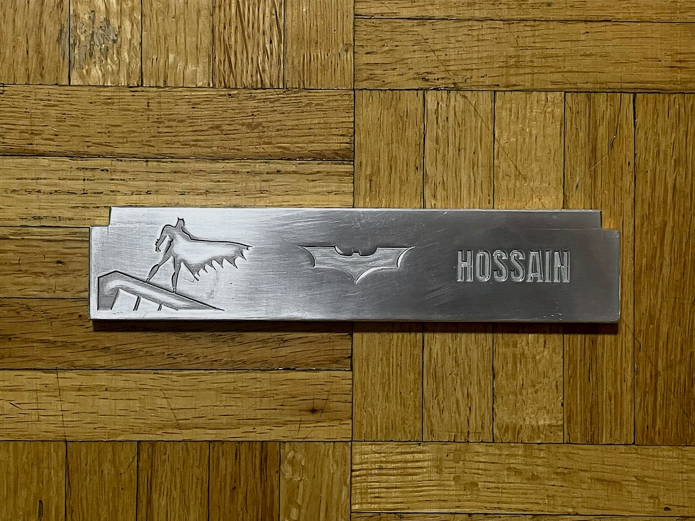
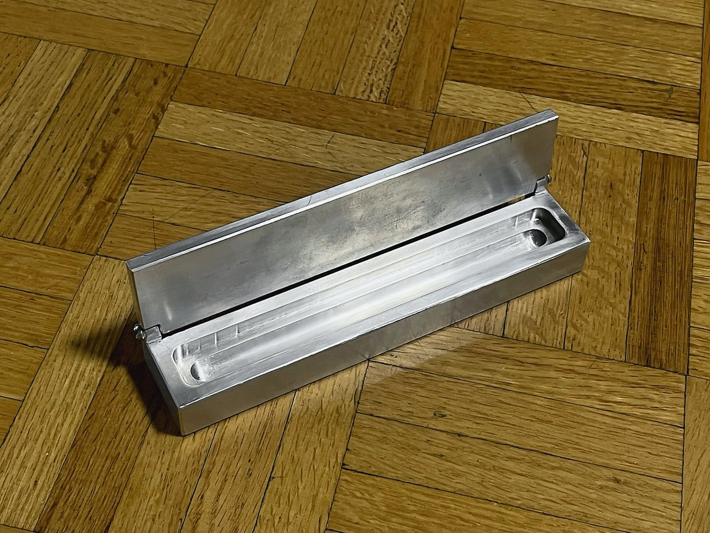
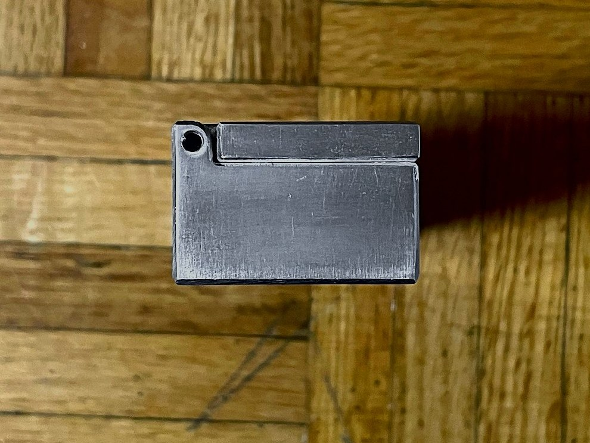
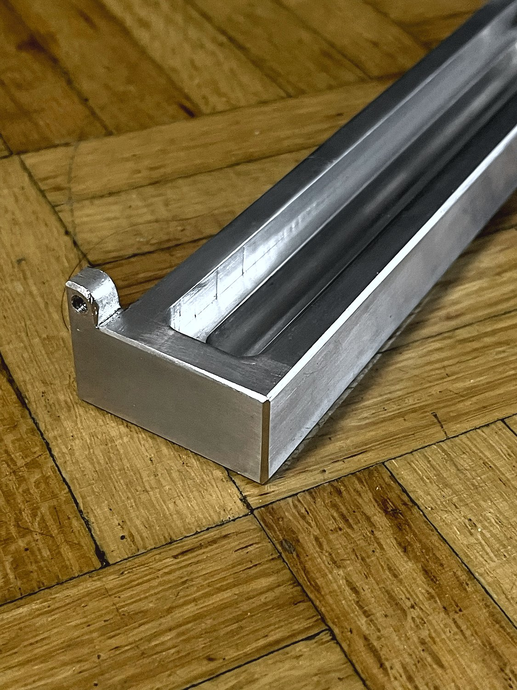
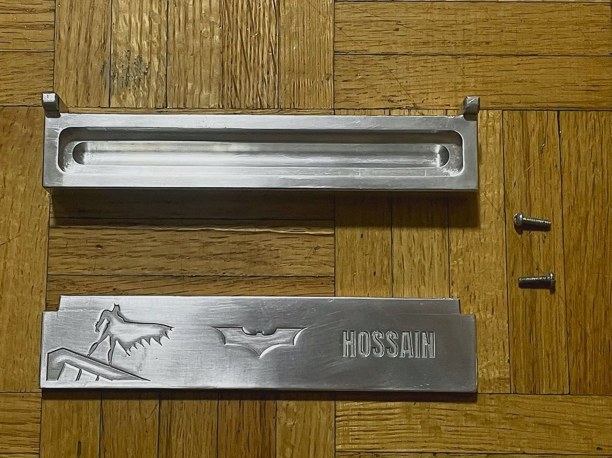

## Overview

A pen and a box to keep it in. I designed both, drew them, and machined every part, using the manual lathe, the manual mill, and a CNC mill programmed in Mastercam.

## Problem / Goal

Make a pen that comes fully apart for refills, and a box with a built-in hinge, with every mating part held to ±0.005 in (0.13 mm) so the threads and the hinge line up.

## What I did

- Designed and drew the pen (three turned parts) and the box (milled base and lid).
- Turned the barrel, tip, and cap on the manual lathe, including drilling, tapping, and thread cutting.
- Milled the box base and lid, and programmed the lid engraving in Mastercam for the CNC mill.

## Process

### The pen: three turned parts and a standard refill

The pen is an aluminum barrel with a brass tip and a brass end cap, all turned on the manual lathe. The barrel is drilled through and tapped at both ends. The tip and cap have matching external threads cut on their shanks.

- **Threaded ends.** Both brass parts unscrew, so the refill can be replaced and the pen comes fully apart.
- **Grip grooves.** Grooves turned into the tip give the fingers something to hold on a polished part.
- **Chamfered mouths.** The barrel openings are chamfered so the brass threads start cleanly instead of cross-threading.
- **Taper and dome.** The tip tapers to the refill point and the cap is rounded, so nothing sharp sits at either end.
- **Relief grooves.** The stepped necks near each end of the barrel mark the transition to the brass and break up the plain cylinder.

> **What made it hard:** The threads on three separate parts have to line up on one axis. If the tapped holes are off-centre, the tip and cap sit crooked and the joint shows.

### The box: a milled case with a built-in hinge

The base and lid are each milled from solid aluminum. The base has a two-level pocket: a wide recess, and inside it a narrower slot sized to the pen so it cannot roll. The slot ends and pocket corners are rounded to the cutter radius, which also leaves no sharp inside corner to collect dirt.

- **Hinge.** Two posts are left standing on the back corners of the base. A machine screw through each post acts as a hinge pin, so the box needs no separate hinge hardware.
- **Rounded posts.** The tops of the posts are filleted. A square corner would catch the lid as it swings; the radius gives it room to rotate freely.
- **Lid.** The lid is notched at both ends to clear the posts, so it closes flush with the base instead of resting on top of them.
- **Engraving.** The lid artwork and my name were programmed in Mastercam and cut on the CNC mill.
- **Edges.** Outside edges are chamfered so the box is comfortable to handle.

> **What made it hard:** The hinge only works if the two screw holes share one axis and the lid notches match the posts. That fit is where the ±0.005 in tolerance mattered most.

## Results / Impact

Both parts work: the pen comes apart for refills, and the box opens and closes on its built-in hinge with the lid sitting flush. Three things did not come out the way I drew them, listed below.

## What I learned

| Defect | What happened | Next time |
| --- | --- | --- |
| Refill protrudes too far | I drilled the refill bore in the tip past its target depth. The refill seats further forward than designed, so the writing point sticks out more than it should. | Set the depth with the quill stop, drill short, and test-fit the refill before taking the bore to final depth. |
| Hinge screws bind | The tapped holes in the box came out tight. The tap drill and tap did not run true to the hole axis, so the threads are undersized and slightly off-axis, and the screws are stiff to drive. | Spot drill first, confirm the tap drill size, and guide the tap from the spindle so it starts square. |
| Rough pocket floor and walls | Heat built up at the cutter while milling the pocket, and the surface finish suffered. That added a lot of hand sanding and polishing. | Use cutting fluid, clear chips more often, take lighter passes, and leave a shallow finishing pass at the end. |
