## Overview

STEM Racing (formerly F1 in Schools) asks student teams to design, build, and race a CO₂-powered car inside a tight rulebook. Our team, Team Lux, formed two weeks before Regionals, qualified, and finished 4th at Nationals, about 10 points out of 1,000 short of the international final. I led the car's design and manufacturing.

This page covers the car. The business side (sponsorship, budget, project management, and brand) is its own project: [STEM Racing: Enterprise & Project Management](/projects/stem-racing-enterprise/).

## Problem / Goal

In a tightly regulated specification series, performance comes from marginal gains. We had almost no track time, so the car had to be developed in simulation, with every change justified by first principles and checked in CFD before it was machined.

The targets were quantifiable from the start: drag coefficient (C_d), frontal area, rolling resistance, and the moment arm between the centre of mass and the centre of pressure.

## What I did

- Led the aerodynamic and mechanical design in Onshape and Fusion 360.
- Ran the CFD workflow in Ansys Discovery and Ansys Fluent, with mentorship from KM Aero on reading the results.
- Planned the machining process and moved production from 5-axis to a 3-axis vacuum-table router.
- Chose the materials for every 3D-printed part.
- Produced the technical drawings and engineering renders for the design portfolio.

## Process

The development followed four stages: research and constraints, then a baseline concept, then CAD development, then optimisation. Every stage fed back into the next.

### Research: where the energy goes

Aerodynamic drag is the dominant force resisting the car:

**F_d = ½ ρ v² C_d A**, and the power it costs is **P_d = ½ ρ v³ C_d A**

Because drag grows with the square of speed (and its power cost with the cube), small reductions in C_d or frontal area A pay off far more than adding downforce. Lift still mattered: too much positive lift unloads the wheels and bearings and hurts stability.

Mechanical losses act the whole length of the track:

- **Rolling resistance** (F_rr = C_rr · m · g): energy lost to deformation at the wheel–track contact.
- **Bearing friction**: a resistive torque τ = r · μ · N that opposes wheel rotation.
- **Surface friction**: F_f = μ · N, with power loss F_f · v rising with speed.

The total loss is the integral of all three along the track, E_loss = ∫(F_d + F_rr + F_f) dx, so the design target was every source of resistance, not just aero. For stability, the centre of pressure and the centre of mass had to stay close, because their offset creates a pitching moment M = (x_cp − x_cm) · F.

### CFD method: two solvers, used for different jobs

Both solvers use the finite volume method. The fluid domain is split into small control volumes, and the conservation equations for mass and momentum are solved on each one. Each cell depends on its neighbours, so the result is a large system of algebraic equations solved iteratively until it converges. Understanding this made us more careful about mesh quality and boundary conditions.

I simplified each new geometry and screened it in Ansys Discovery's real-time solver. Only the designs that survived went to Ansys Fluent for a steady-state RANS run.

| Setting | Value | Why |
| --- | --- | --- |
| Freestream | 25 m/s velocity inlet | Typical competition speed |
| Floor | Moving at 25 m/s | Matches the ground under a real car |
| CO₂ jet | 80 m/s velocity inlet | Subsonic exit velocity, to model momentum and mixing |
| Wheels | Rotating at 1,785 rad/s | Rolling at track speed |
| Domain | Half car, symmetry plane | Same answer for a fraction of the mesh |
| Reynolds no. | About 374,000 (L = 0.22 m) | Viscous and inertial effects both matter, so geometry is critical |

> **Why this way:** Fluent is accurate but slow. Screening in Discovery first meant the expensive runs were spent only on designs worth measuring. For small changes we edited the mesh directly instead of re-simplifying the whole CAD model.

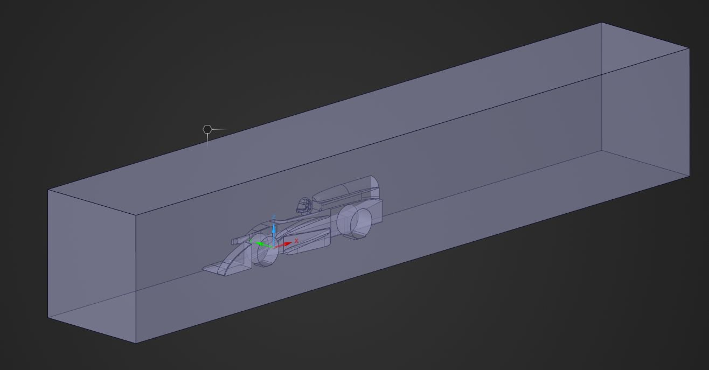
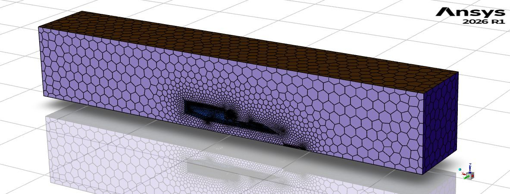

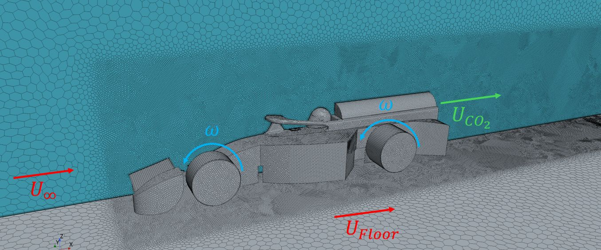

### Baseline concept: finding where the energy went

Instead of drawing several unrelated concepts, we built one deliberately simple baseline car and studied it closely. It made **0.64 N of drag (C_d = 0.167)** and **0.52 N of downforce (C_l = 0.135)**, and it showed four problems:

1. The front wing made strong suction but lost energy at the sharp junctions between wing, endplate, and support.
2. Wake from the front wheels was being drawn under the floor.
3. Flow separated off the sidepods and re-entered the floor through openings ahead of the rear wheels.
4. The diffuser's suction peak arrived late and weak, which added pressure drag.

The design actions followed directly: reprofile the wing supports, use outwash and sidepod shape to keep wheel wake out of the floor, close or re-angle the floor openings, and move the diffuser's kick point forward with a smooth 5–10° expansion.

> **Why this way:** One controlled baseline let us change a single feature at a time and know which change caused which result.

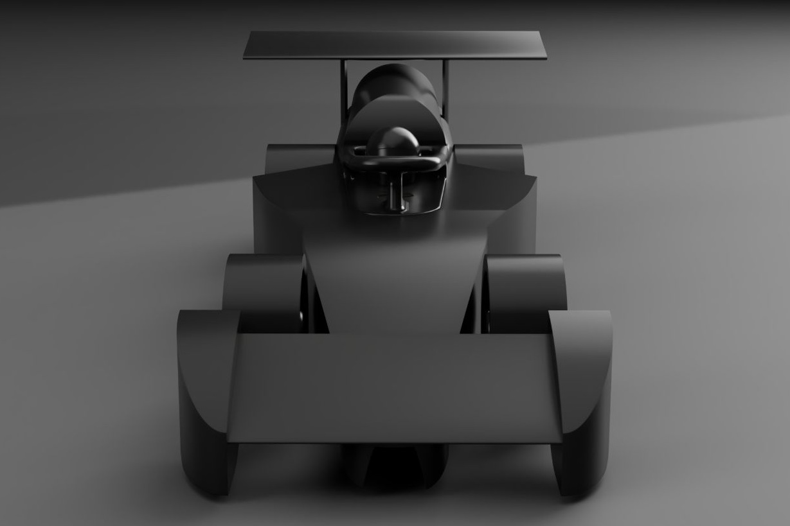

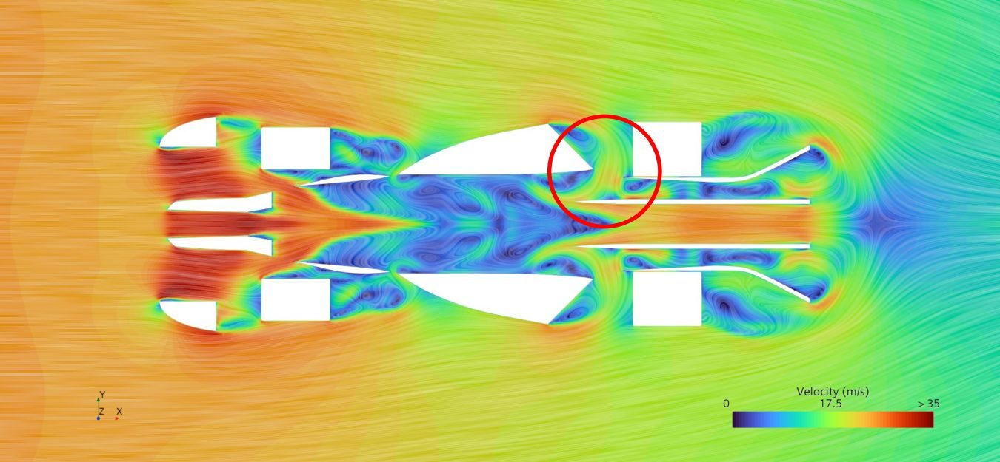
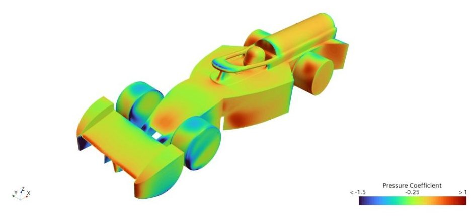
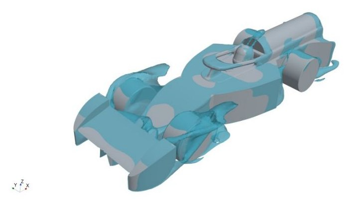

### Wings: three front wings, four rear wings

**Front wing.** The first wing used a high-downforce profile, inspired by older F1 cars, for stability. Once the sidepods were doing that job, I moved to an aggressive Formula E–style wing with more outwash to push air around the front tyres. It was faster but hard to balance and to make. The final wing combined the best of both, with a neutral profile and reshaped endplates that keep wheel wake out of the floor.

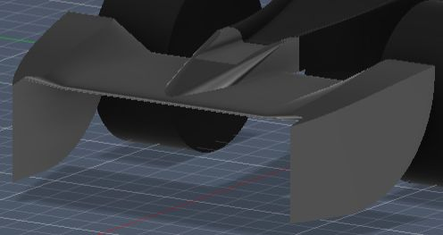
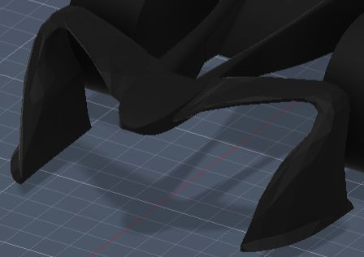
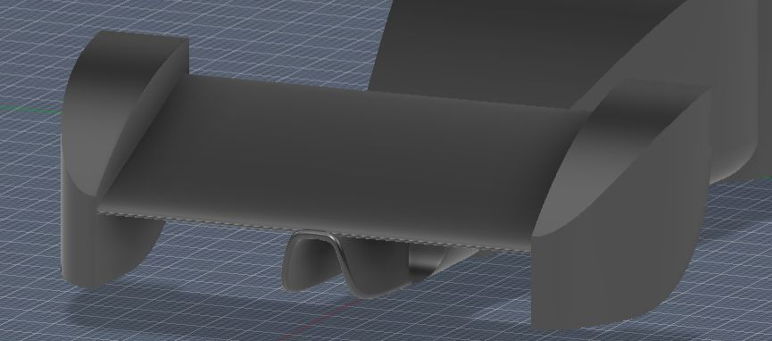

**Rear wing.** The first rear wing was a simple plate for stability and easy manufacturing. The second added a proper support structure. It worked, but it needed more refinement, so we ran a simpler box-section wing at Test Day. The final wing refined the support-structure design to balance downforce against drag.

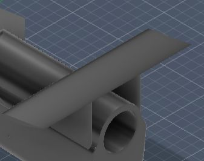
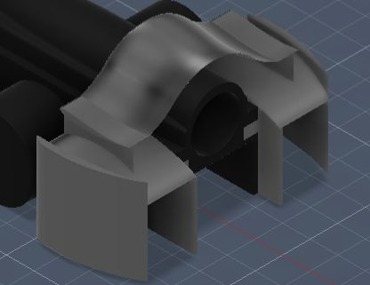

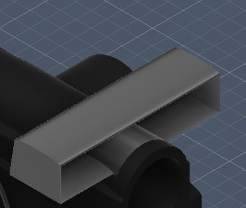
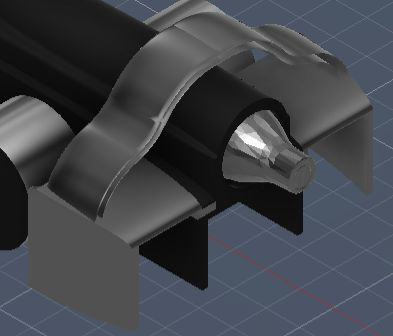

### Body and sidepods: three of each

**Sidepods.** A blunt first version gave way to aggressive side scoops. CFD showed their sharp edges caused separation, and they were hard to machine consistently, so the final version is a smooth taper that keeps flow attached and shields the rear wheels.

**Body.** Wide and flat at first, then a trimmed nose to cut frontal area, then fully rounded edges for a teardrop shape with a small wake. Before every mesh export, I checked surface continuity with zebra striping and a minimum-radius analysis.

Under identical simulation conditions, drag fell from 0.45 N on the first race design to 0.229 N on the final car.

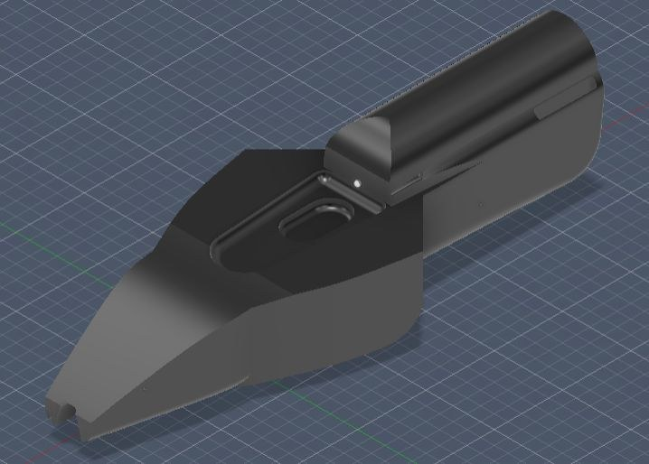
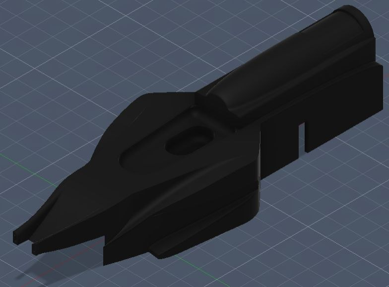
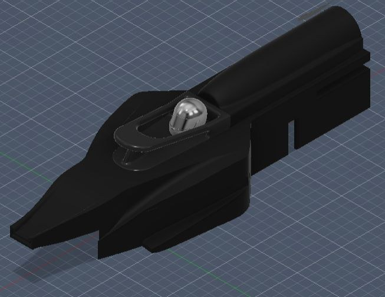

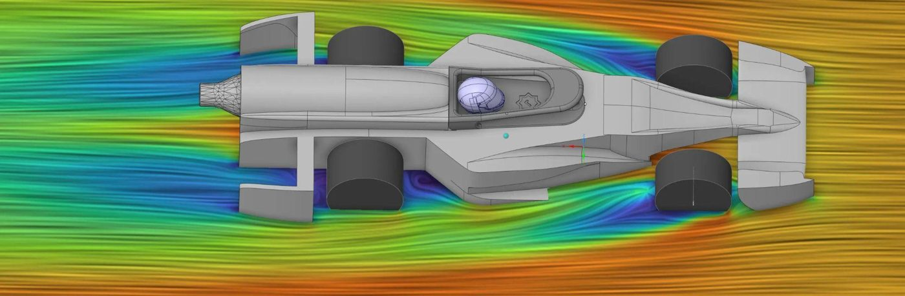
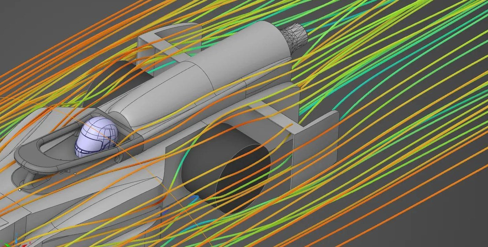

### Wheels: removing the axle

The first car used a rod through the body with a wheel pressed on each end. It was quick to build, but the body needed clearance channels for the rod, which added frontal area, and lining it up at the track took time.

The final design has no through-axle. Each SLS-printed wheel carries a toleranced bearing pocket, and matching recesses in the wheel and the chassis mount hold the bearing in place radially and axially. The wheel itself has a symmetric airfoil cross-section to reduce the drag of a spinning wheel.

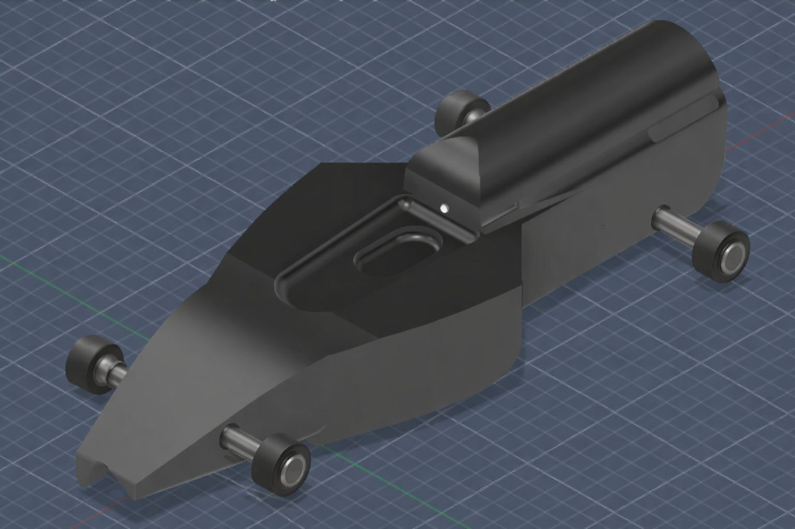
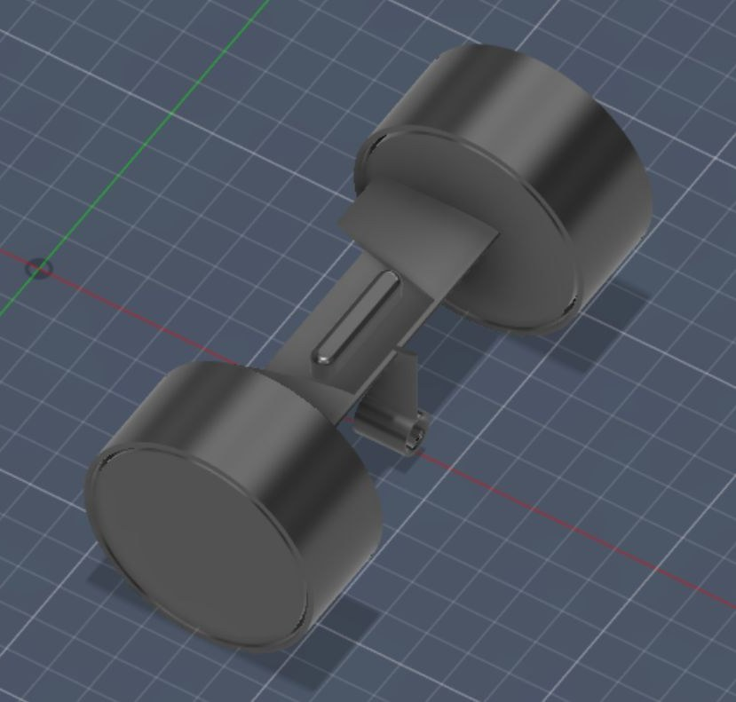

### Manufacturing: why we dropped 5-axis

The body's sidepod cutouts and blended curves pointed to 5-axis machining on a trunnion table, and the CAM simulation agreed. The foam did not. Tooling foam has low shear strength, so it distorts under vice jaws or toe clamps, and any fixture blocked toolpaths. The rotary axes also added positional error, so the 5-axis setup created more variation than it removed.

The rules require every body to be cut from its own official foam block, so a ruined block costs both money and days. We moved to a 3-axis router with a vacuum table, which holds each block evenly across its whole base, and machined every body from four sides:

1. **Roughing** with trochoidal toolpaths, which keep radial engagement constant so the tool doesn't see load spikes or deflect.
2. **Rest machining** with smaller ball-nose cutters to clear what the roughing tool could not reach.
3. **Finishing passes** with a tight stepover, oriented along the flow direction, leaving ridges under 0.025 mm on the aerodynamic surfaces.

For printed parts I tested PLA and PETG for form studies, SLA resin for low-friction surfaces, and carbon-fibre-filled filament for high-stress parts.

> **Why this way:** With a limited supply of regulation blocks, a reliable process mattered more than fewer setups. When every car is the same shape, a faster run means the design improved, not the machining.

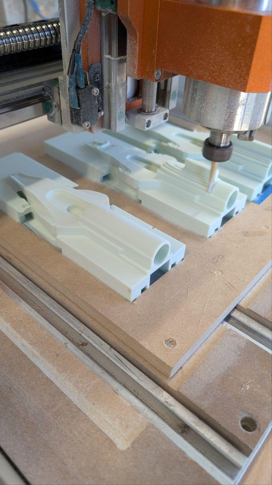
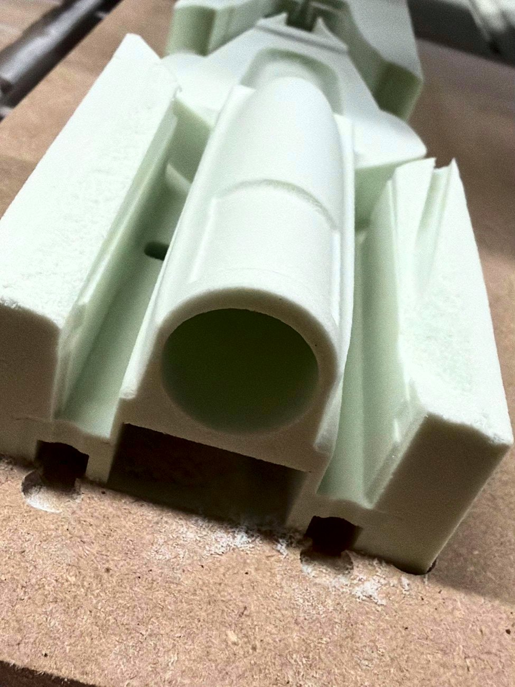

## Results / Impact

Four cars across the season: one for Regionals, a major redesign for Test Day, and two matched final cars for Nationals. The final car's simulated drag was 49% lower than the first race design (0.45 N to 0.229 N). We placed **4th overall in Canada**.

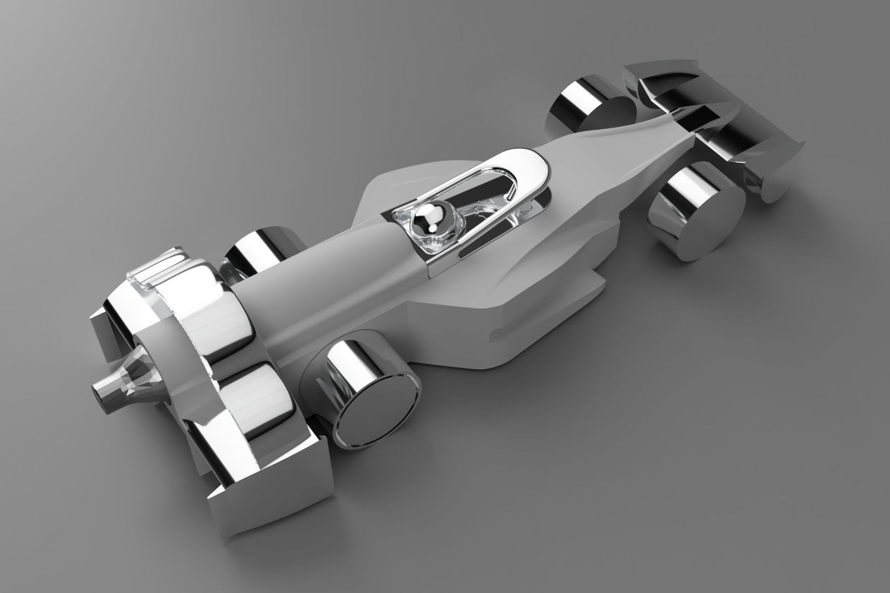
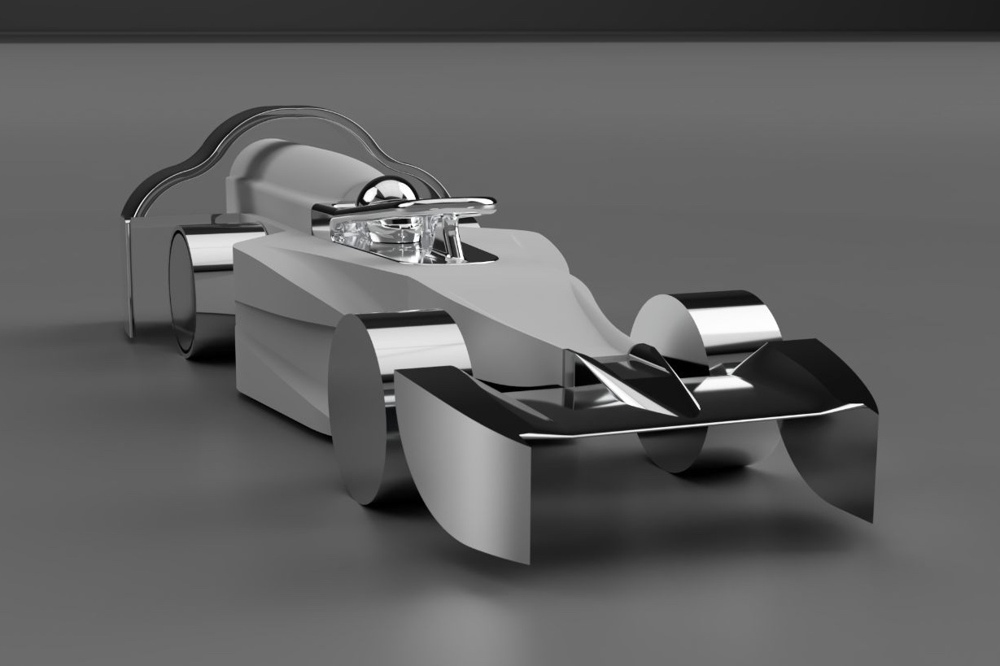

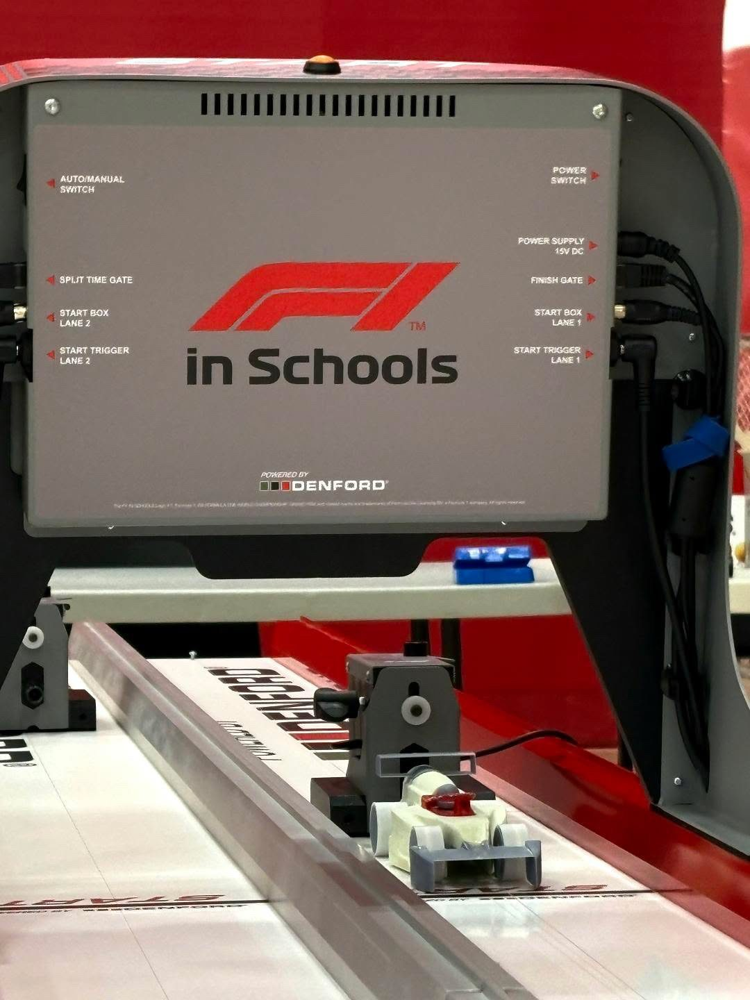
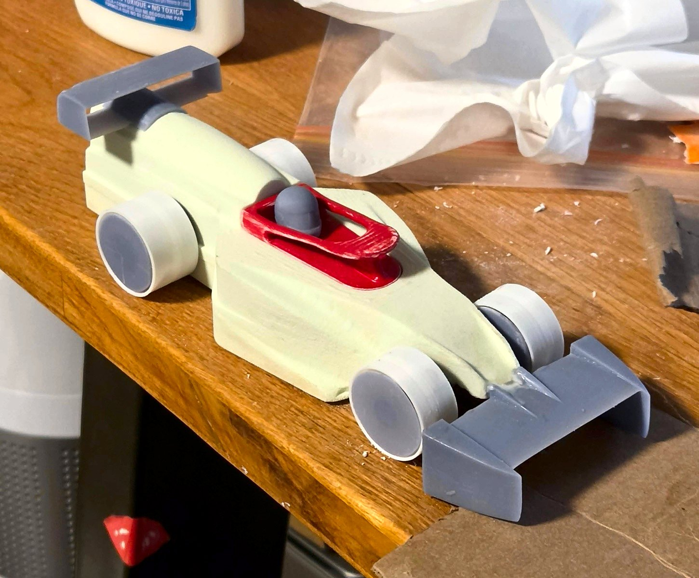

## What I learned

We finished about 10 points out of 1,000 short of qualifying for internationals. These are the things that cost us time or performance.

| Issue | What happened | Next time |
| --- | --- | --- |
| First design had twice the drag | The first car was drawn quickly, before we had studied the flow. CFD later traced its 0.45 N of drag to a blunt nose, front-wheel wake pulled under the floor, and a diffuser that separated. | Run a baseline flow study on a simple car before committing to a full design. |
| Sidepod scoops that separated | The second sidepod design used aggressive scoops. Their sharp edges caused flow separation, and they were hard to machine the same way twice. | Check each new feature for machinability at the same time as its CFD result, not after. |
| Through-axle added drag | The first wheel system ran a rod through the body. The clearance channels added frontal area, and aligning the rod at the track cost setup time. | Design the wheel mounting together with the body, instead of adding it to a finished shape. |
| 5-axis machining failed on foam | CAM simulation said 5-axis was the right process. In practice the foam distorted when clamped and the fixtures blocked toolpaths, so parts varied more, not less. | Cut a test piece in the real material before planning the process around a simulation. |
| Very little track testing | Joining two weeks before Regionals left almost no track time, so the car was developed in CFD with few timed runs to confirm the predictions. | Schedule timed track runs for each car version so the simulation is checked against real results. |
