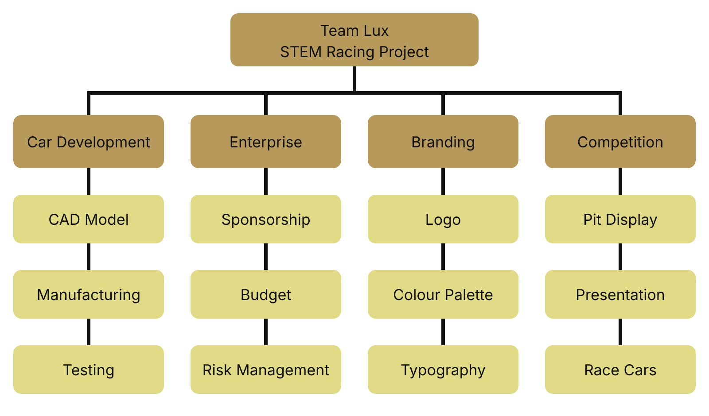
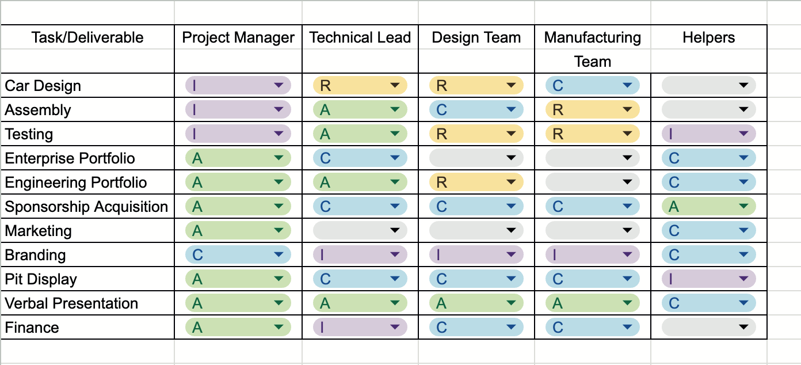
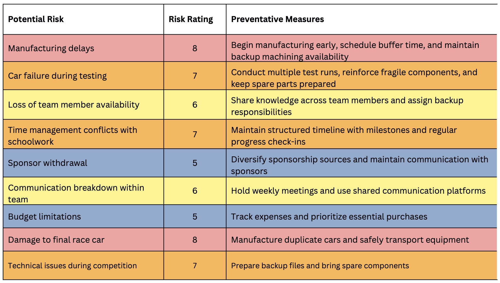
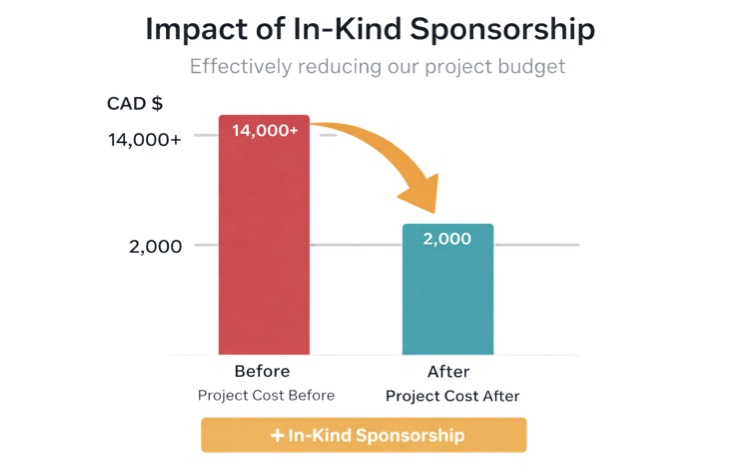
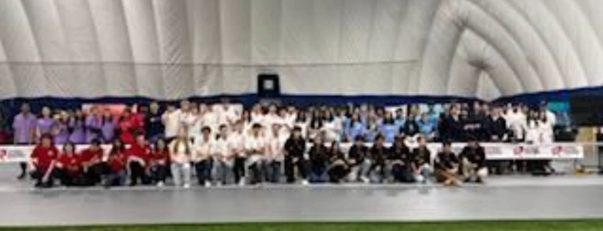

## Overview

STEM Racing is judged on more than lap times: teams also submit an enterprise portfolio, a presentation, and a pit display, scored on project management, sponsorship, and brand. This is how we funded, scheduled, and ran a team that started two weeks behind everyone else.

The car itself has its own page: [STEM Racing: Engineering](/projects/stem-racing/).

## The goal

Plan the season so six members and three helpers could work in parallel without waiting on each other, and fund about $11,900 from nothing. The charter fixed the deliverables: two track-ready cars, two 10-page portfolios, a 10-minute presentation, and a zero-waste pit display.

## What I did

- Ran operations: project charters, work breakdown, schedule, risk register, and budget.
- Built the sponsorship outreach system and handled a large share of sponsor contact myself.
- Kept the stakeholder register and milestone check-ins with every sponsor.

## Process

### Planning: scope, schedule, owners

Four work streams (Car Development, Enterprise, Branding, Competition), each broken into tasks with an owner and acceptance criteria. A shared Gantt chart ran from November to Nationals, with Regionals and Test Day as checkpoints, and a RACI matrix gave every deliverable exactly one accountable owner. Weekly one-hour meetings and written status reports kept everyone on the same plan.

### Risk register

Nine risks rated by likelihood and impact. The top two, manufacturing delays and damage to the final car, both rated 8, so we started machining early, kept buffer time, and built duplicate cars and spare parts.

It was tested once: a rules mix-up ruined a regulation foam block with no spare in stock. Our title sponsor, GH Precision, sourced a replacement the same day, and we were cutting again within hours.

### Sponsorship: offering value, not asking for money

- **Outreach.** 1,000+ companies split across the team: cold call, follow-up, sponsorship package, then regular contact.
- **In-kind first.** Many companies couldn't give money but could give machining, printing, or expertise, which cut our projected cash budget from over $14,000 to about $2,000.
- **Return for sponsors.** Placement on the car, jerseys, and pit display, plus social posts and website visibility.

The result: $4,000 in cash and $7,600 in kind from more than 15 sponsors, plus software and CFD mentorship.

### Brand

The name comes from our school motto, *Lux numquam desit* ("the light will never fail"), and the Port Credit lighthouse; the palette is black and gold. We grew a verified Instagram to 300+ followers and promoted every sponsor there.

## Results

At the 2026 National Championships: **1st in Pit Display**, **2nd in Project Management**, **3rd in Brand Identity**, and **4th overall**. Every deliverable was on time. The zero-waste pit display was built from repurposed workshop materials, and the lighthouse at the back is a model I designed and 3D printed.

## What I learned

On a short timeline the plan has to be visible: a chart everyone can see lets people pick up the next task without asking.

| Area | What happened | Next time |
| --- | --- | --- |
| Ruined block, no spare | Production stopped until a sponsor sourced a replacement. | Keep a spare block, and check each setup against the rules before cutting. |
| Compressed timeline | Little buffer was left between testing and final production. | More buffer between milestones; start final prep earlier. |
| Communication gaps | Scheduling conflicts cut full-team meetings in busy periods. | Structured check-ins and one shared place for status. |
| Local reach | Marketing reached mostly our school and community. | Expand to more platforms and a broader audience. |
