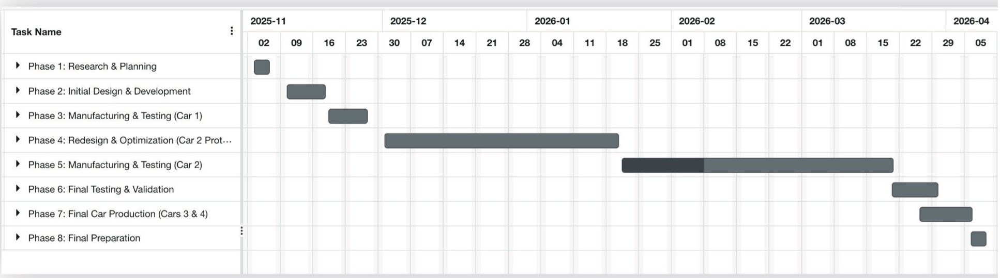
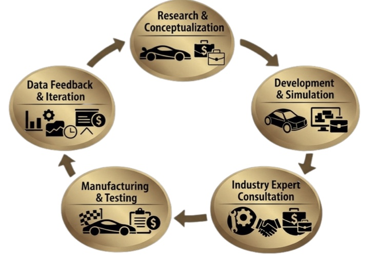
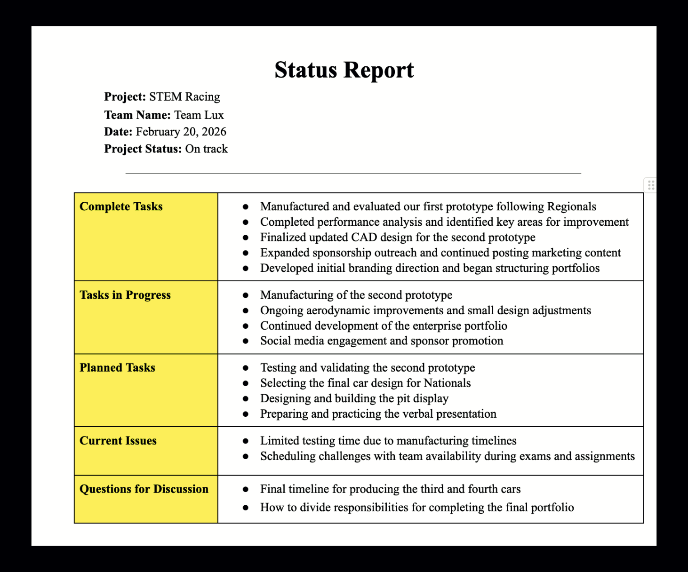
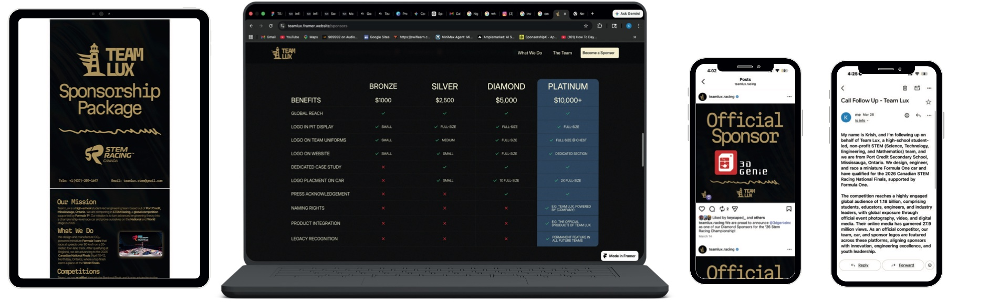
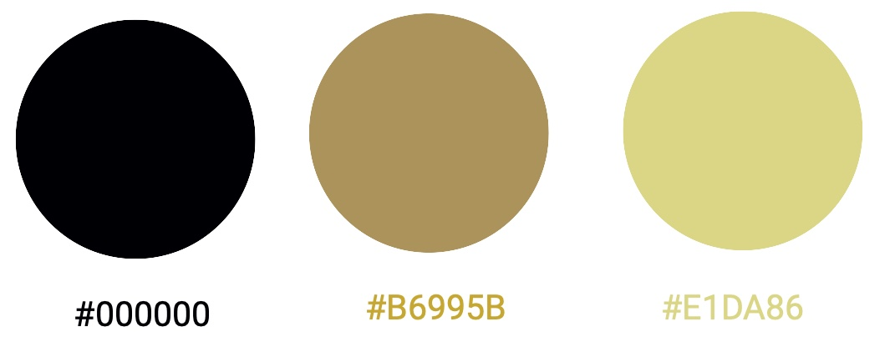
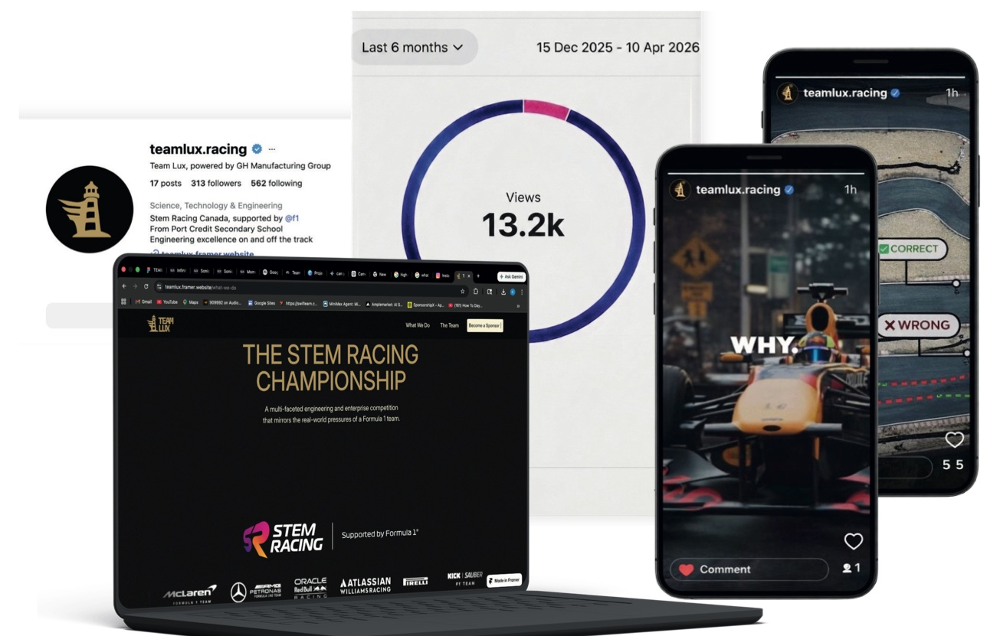
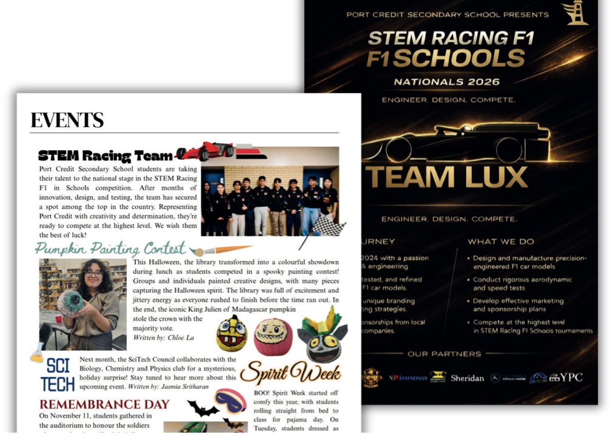
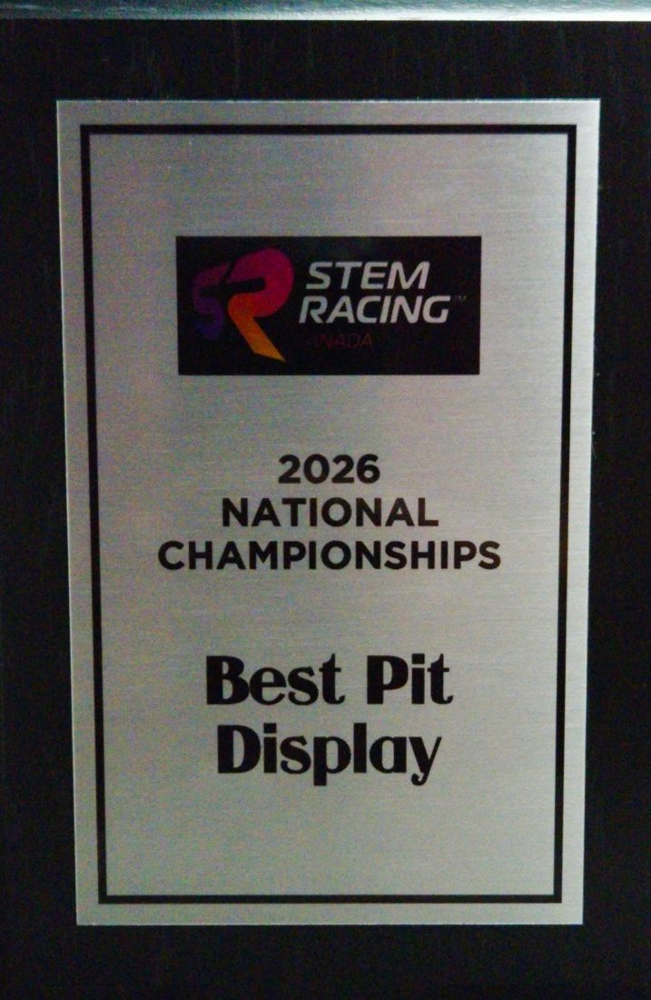
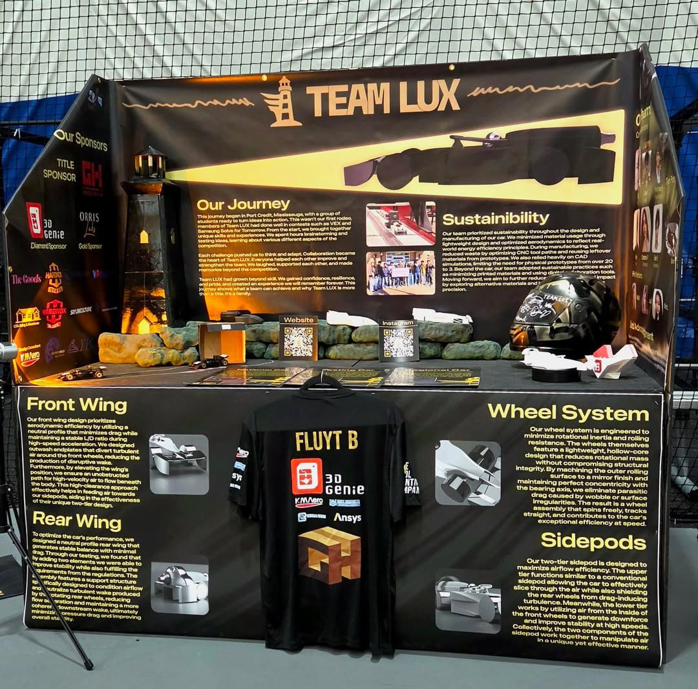

## Overview

STEM Racing is judged on more than lap times. Teams also submit an enterprise portfolio, a verbal presentation, and a pit display, and are scored on project management, sponsorship, and brand. This is the business side of Team Lux's season: how we funded, scheduled, and ran a team that started two weeks behind everyone else.

The car itself is its own project: [STEM Racing: Car Design & Engineering](/projects/stem-racing-car/).

## Problem / Goal

We were invited two weeks before Regionals, so every other team had a head start. The project had to be planned so that six members and three helpers could work in parallel without waiting on each other. We also had to fund a season of about $11,900 from nothing.

The charter set the deliverables up front: two track-ready cars, two 10-page portfolios, a 10-minute presentation, and a zero-waste pit display.

## What I did

- Ran the team's operations: the project charters, work breakdown, schedule, risk register, and budget.
- Built the sponsorship outreach system and handled a large share of the sponsor contact myself.
- Kept the stakeholder register and the milestone check-ins with every sponsor.

## Process

### Charter, scope, and work breakdown

We wrote a project charter in November and a second one after qualifying, when the targets changed. The scope covered the car, both portfolios, the pit display, the presentation, branding, and sponsorship. Anything outside that list was cut.

The work was split into four streams: Car Development, Enterprise, Branding, and Competition. Each stream was broken into tasks, and each task had an owner and acceptance criteria, such as rule compliance for the car and clarity for the portfolios.

### Schedule and accountability

A shared Gantt chart ran from early November to Nationals in April. Regionals and Test Day were the checkpoints where we compared progress to plan and re-ordered tasks. A RACI matrix gave every deliverable exactly one accountable owner.

### Communication

We held weekly one-hour meetings at school, with attendance tracked. Between meetings we used a group chat and calls for quick updates, and longer in-person sessions for big pushes. Setbacks were worked through around a physical board until there was a way around them. Written status reports kept completed, in-progress, and planned work visible to everyone, along with current issues.

### Risk register

Nine risks were rated by likelihood and impact, and the highest were handled first. Manufacturing delays and damage to the final car both rated 8, so we started machining early, kept buffer time, and built duplicate cars and spare parts.

The plan was tested once. A rules mix-up during machining ruined a regulation foam block and stopped production with no spare in stock. Our title sponsor, GH Precision, drove out to source a replacement the same day, and we were cutting again within hours.

### Sponsorship: from asking for money to offering value

We started with one goal: funding. We soon learned that companies respond to value, not requests, so we pitched Team Lux as a platform sponsors could grow alongside.

- **Outreach system.** A list of more than 1,000 local and national companies was split across the team and colour-coded. The process ran cold call, follow-up call, sponsorship package, and then regular contact.
- **Multi-channel.** We used calls, tracked email proposals with our website and package attached, a sponsorship page on the website, Instagram, and personal networks.
- **In-kind first.** Many companies couldn't give money but could give materials, machining, printing, or expertise. Prioritising in-kind support cut our projected cash budget sharply.
- **Return for sponsors.** Sponsors got brand placement on the car, jerseys, and pit display, plus social posts, website visibility, and recognition at events.
- **Stakeholder register.** Every sponsor who signed on was logged with the last contact, who on the team owned the relationship, and how they preferred to be reached. We checked in with each one at milestones.

The result was $4,000 in cash and $7,600 of in-kind CNC machining and 3D printing from more than 15 sponsors, plus software and CFD mentorship.

### Brand and marketing

The name comes from our school motto, *Lux numquam desit* ("the light will never fail"), and from the Port Credit lighthouse. The logo combines the lighthouse with the motion of the F1 mark. The palette is black and gold: light shining through darkness.

Online, we built a verified Instagram account with 300+ followers, used polls and Q&As to see what content worked, and promoted every sponsor. Offline, we put up posters at school, appeared in the school newsletter, and left printed slips in libraries and recreation centres.

## Results / Impact

At the 2026 National Championships we placed **1st in Pit Display**, **2nd in Project Management**, and **3rd in Brand Identity**, and **4th overall**. Every deliverable was on time, and four cars were built across the season. The pit display was zero-waste, built from repurposed workshop materials. The lighthouse at the back is a model I designed and 3D printed.

## What I learned

> On a short timeline the plan has to be visible. A register and a chart that everyone can see let people pick up the next task without asking, and the top-rated risks got attention while there was still time to act.

| Area | What happened | Next time |
| --- | --- | --- |
| Ruined block, no spare | A rules mix-up during machining ruined a regulation block with no spare in stock, and production stopped until a sponsor sourced a replacement. | Keep at least one spare block on hand, and check each setup against the rules before cutting. |
| Compressed timeline | The schedule tightened in the final stages, leaving little buffer between testing and final production. | Build more buffer between milestones and start final preparation earlier. |
| Communication gaps | Scheduling conflicts cut full-team meetings, and updates slipped in busy periods. | More structured check-ins and a single shared place for status. |
| Local reach | Marketing reached mostly our school and community. | Expand to more platforms and target a broader audience. |
