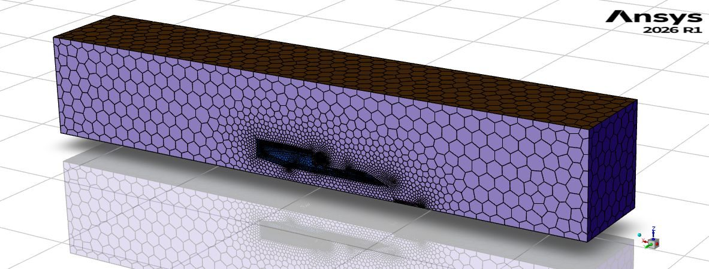
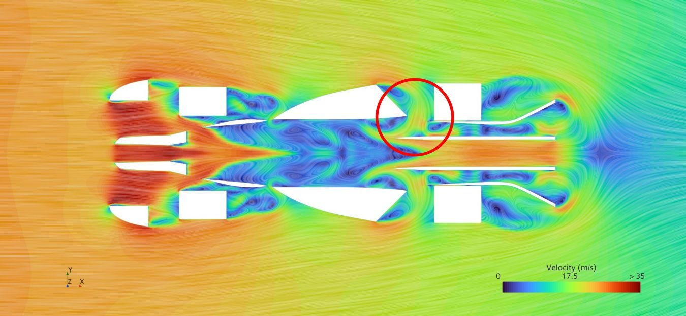
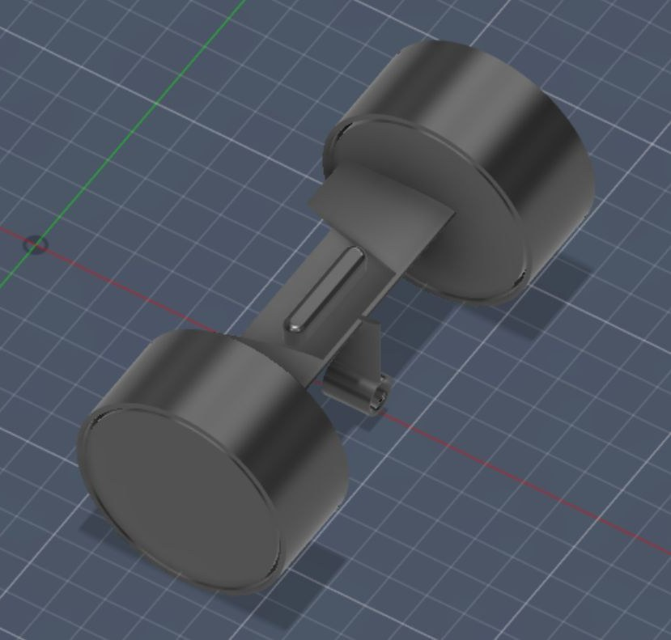
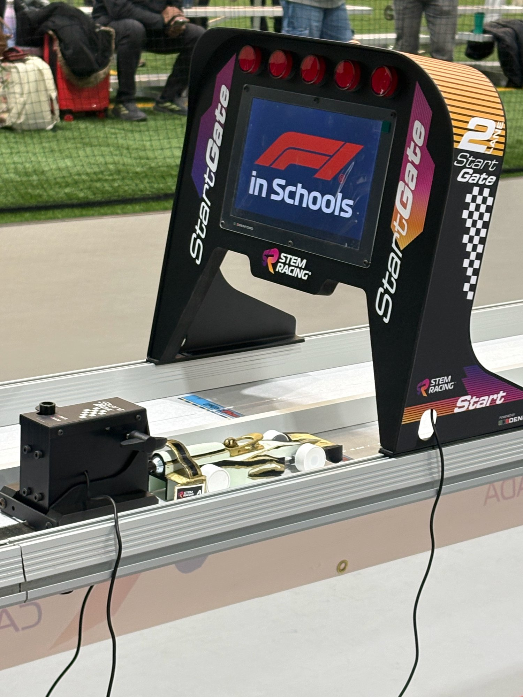

## Overview

STEM Racing (formerly F1 in Schools) asks student teams to design, build, and race a CO₂-powered car inside a tight rulebook. Team Lux formed two weeks before Regionals, qualified, and finished 4th at Nationals, about 10 points out of 1,000 short of the international final. I led the car's design and manufacturing.

The business side (sponsorship, scheduling, and the enterprise awards) has its own page: [STEM Racing: Enterprise](/projects/stem-racing-enterprise/).

## The goal

With almost no track time, the car had to be developed in simulation. Every change was checked in CFD before it was machined, against four targets: drag coefficient (Cd), frontal area, rolling resistance, and the gap between the centre of mass and the centre of pressure.

## What I did

- Led the aerodynamic and mechanical design in Onshape and Fusion 360.
- Ran the CFD workflow in Ansys Discovery and Ansys Fluent, with mentorship from KM Aero on reading the results.
- Planned the machining process and moved production from 5-axis to a 3-axis vacuum-table router.
- Chose the materials for every 3D-printed part, and produced the drawings and renders for the design portfolio.

## Process

### CFD: screen fast, then measure

New shapes were screened in Ansys Discovery's real-time solver. Only the ones that survived went to Ansys Fluent for a steady-state RANS run: a half car on a symmetry plane, 25 m/s freestream over a moving floor, an 80 m/s CO₂ jet, and wheels spinning at track speed (Reynolds number about 374,000).

### Baseline: finding where the energy went

We built one deliberately simple car and studied it before designing the real one. It made **0.64 N of drag (Cd = 0.167)** and showed four problems: energy lost at the front-wing junctions, front-wheel wake pulled under the floor, separated flow off the sidepods re-entering the floor, and a late, weak diffuser. Each later change targeted one of these, so we always knew which change caused which result.

### Iterations: first race car to final car

The first race car, the prototype, before any of the CFD-driven changes below:

- **Front wing.** From a high-downforce profile to a neutral one, with endplates reshaped to push wheel wake around the tyres instead of under the floor.
- **Rear wing.** From a flat plate to a supported wing tuned for downforce against drag.
- **Sidepods.** Aggressive scoops separated at their sharp edges and were hard to machine, so the final version is a smooth taper that keeps flow attached.
- **Body.** A trimmed nose cut frontal area, and fully rounded edges gave a teardrop shape with a small wake. I checked every surface with zebra striping before meshing.

Under identical conditions, drag fell from **0.45 N to 0.229 N**.

### Wheels: removing the axle

The first car ran a rod through the body, which needed clearance channels (more frontal area) and slow alignment at the track. The final car has no axle: each SLS-printed wheel holds a bearing in a toleranced pocket, retained by matching recesses in the chassis mount, and the wheel has an airfoil cross-section to cut spinning drag.

### Manufacturing: why we dropped 5-axis

CAM simulation pointed to 5-axis machining, but the tooling foam distorted under clamps, fixtures blocked toolpaths, and the rotary axes added error. Since every body must come from its own regulation block, we switched to a 3-axis router with a vacuum table and cut each body from four sides: trochoidal roughing, rest machining with small ball-nose cutters, then finishing passes along the flow direction that left ridges under 0.025 mm.

Printed parts: PLA and PETG for form studies, SLA resin for low-friction surfaces, and carbon-fibre-filled filament for high-stress parts.

## Results

Four cars across the season, ending with two matched cars for Nationals. Simulated drag was 49% lower than the first race design, and we placed **4th overall in Canada**.

 on the start gate at Nationals.")

## What I learned

| Issue | What happened | Next time |
| --- | --- | --- |
| First design had twice the drag | Drawn before we had studied the flow. CFD later traced its 0.45 N to a blunt nose, wheel wake under the floor, and a separating diffuser. | Run a baseline flow study before committing to a design. |
| Sidepod scoops separated | Sharp edges caused separation and were hard to machine consistently. | Check machinability alongside each CFD result. |
| Through-axle added drag | Clearance channels added frontal area and setup time. | Design wheel mounting together with the body. |
| 5-axis failed on foam | Clamping distorted the foam, so parts varied more, not less. | Cut a test piece in the real material before committing to a process. |
| Little track testing | Joining late left few timed runs to check the CFD. | Schedule timed runs for every car version. |

