## Overview

STEM Racing (formerly F1 in Schools) asks student teams to design, build, and race a CO₂-powered car inside a tight rulebook. Our team formed two weeks before Regionals, qualified, and finished 4th at Nationals, about 10 points out of 1,000 short of the international final. I led the car's design and manufacturing and ran the team's operations and sponsorship.

## Problem / Goal

Build the fastest car the rules allow, and a team and budget to match, starting two weeks behind every other team. We were invited two weeks before Regionals and had almost no track time, so the car had to be developed in simulation and the project had to be run so that people could work in parallel from day one.

## What I did

- **Car design:** led the aerodynamic and mechanical design in Onshape and Fusion 360, and ran the CFD in Ansys Discovery and Ansys Fluent.
- **Manufacturing:** planned the machining process, moved production from 5-axis to a 3-axis vacuum-table router, and chose the materials for every 3D-printed part.
- **Operations:** wrote the project charters, work breakdown, Gantt chart, risk register, and budget for a team of six members and three helpers.
- **Sponsorship:** built the outreach system that raised $4,000 in cash and $7,600 in kind from more than 15 sponsors.
- **Pit display:** designed and 3D printed the lighthouse model at the back of the display.

## Process

### Step 1: Two solvers, used for different jobs

We had almost no track time, so the car was developed in CFD. I simplified each new geometry in Ansys Discovery and used its real-time solver to screen ideas in minutes. Only the designs that survived went to Ansys Fluent for a steady-state RANS run.

| Setting | Value |
| --- | --- |
| Freestream | 25 m/s, with the floor moving at 25 m/s |
| CO₂ jet | 80 m/s velocity inlet |
| Wheels | Rotating at 1,785 rad/s |
| Domain | Half car with a symmetry plane |
| Reynolds no. | About 374,000 (L = 0.22 m) |

> **Why this way:** Fluent is accurate but slow. Screening in Discovery first meant the expensive runs were spent only on designs worth measuring. The half-car domain gave the same answer for a fraction of the mesh.

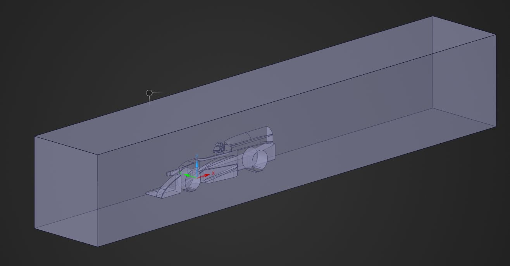
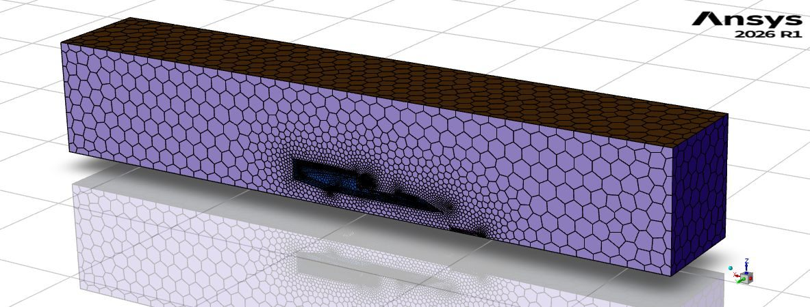

### Step 2: Finding where the energy went

Instead of drawing several unrelated concepts, we built one baseline car and studied it closely. With guidance from our CFD mentors at KM Aero on reading the results, the baseline showed four problems:

1. The front wing made strong suction but lost energy at the sharp junctions between wing, endplate, and support.
2. Wake from the front wheels was being drawn under the floor.
3. Flow separated off the sidepods and re-entered the floor through openings ahead of the rear wheels.
4. The diffuser's suction peak arrived late and weak, which added pressure drag.

> **Why this way:** One controlled baseline let us change a single feature at a time and know which change caused which result.

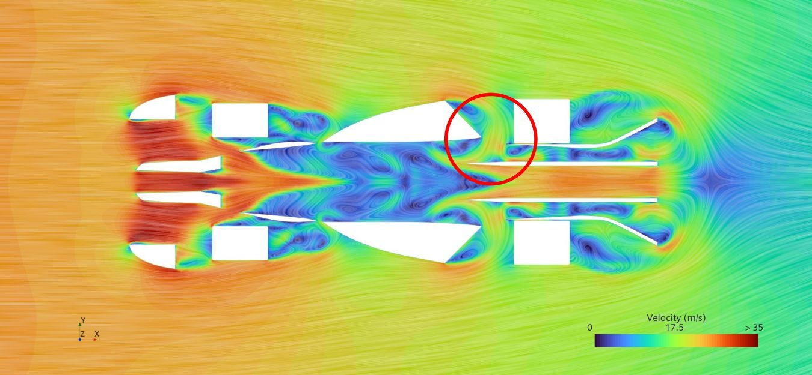
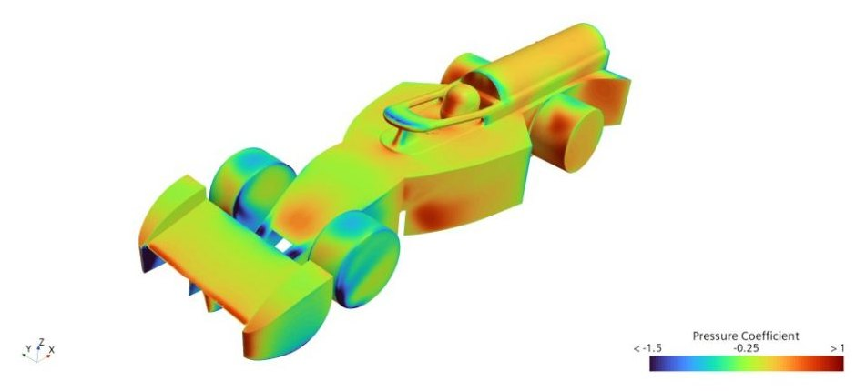
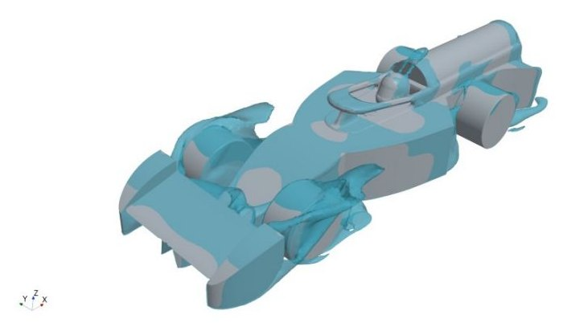

### Step 3: Four front wings, three rear wings, three bodies

**Front wing.** The first wing used a high-downforce profile for stability. Once the sidepods were doing that job, I moved to a neutral profile and reshaped the endplates to push air outward around the front tires, keeping wheel wake out of the floor.

**Sidepods.** A blunt first version gave way to aggressive side scoops. CFD showed their sharp edges caused separation, and they were hard to machine consistently, so the final version is a smooth taper that keeps flow attached and shields the rear wheels.

**Body.** Wide and flat at first, then a trimmed nose to cut frontal area, then fully rounded edges for a teardrop shape with a small wake.

**Rear wing.** Started simple, gained a proper support structure, and was then refined to balance downforce against drag.

Under identical simulation conditions, drag fell from 0.45 N on the first design to 0.229 N on the final car.

> **Why this way:** Drag grows with the square of speed, so frontal area and attached flow mattered more than adding downforce. Every change also had to stay machinable in foam.

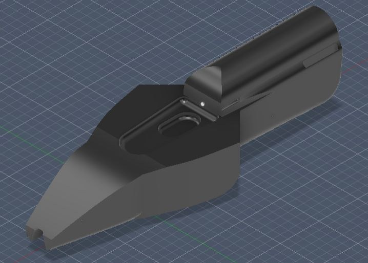
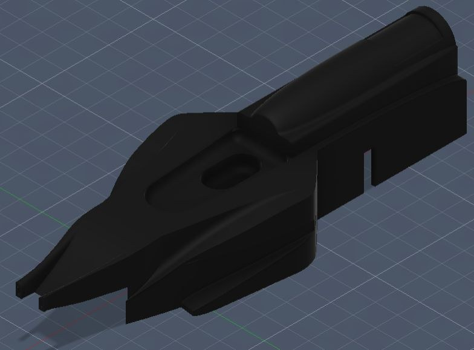
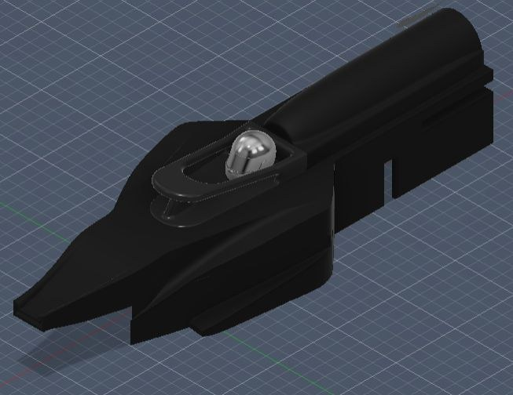

Body and sidepod iterations in CAD. Each version rounded more of the edges, for the same reason as any fillet: so nothing catches, here the airflow.

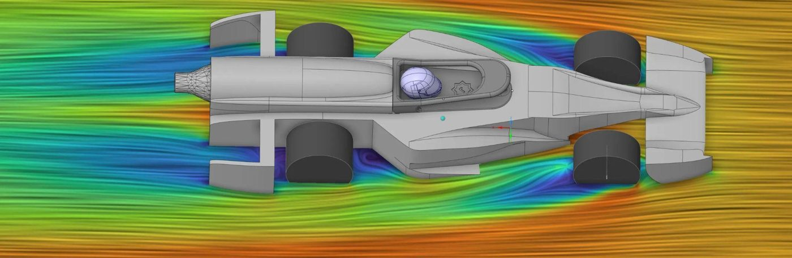
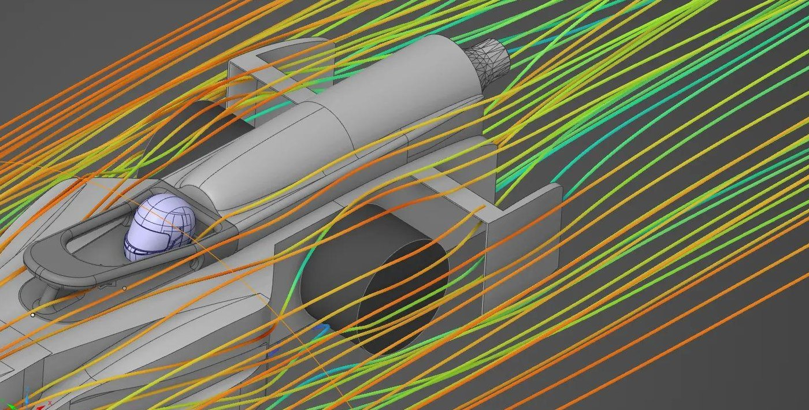

### Step 4: Removing the axle

The first car used a rod through the body with a wheel pressed on each end. It was quick to build, but the body needed clearance channels for the rod, which added frontal area, and lining it up at the track took time.

The final design has no through-axle. Each SLS-printed wheel carries a toleranced bearing pocket, and matching recesses in the wheel and the chassis mount hold the bearing in place radially and axially. The wheel itself has a symmetric airfoil cross-section to reduce the drag of a spinning wheel.

> **Why this way:** No axle bore means no drag from it and a slimmer body. Setup at the track became a matter of seating the wheels instead of feeding and aligning a rod.

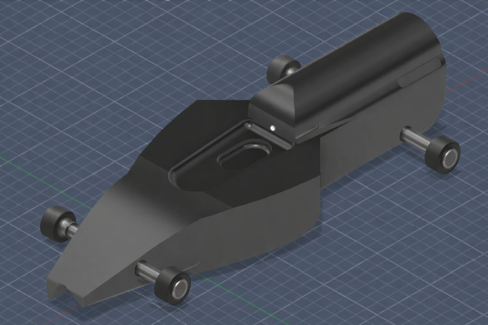
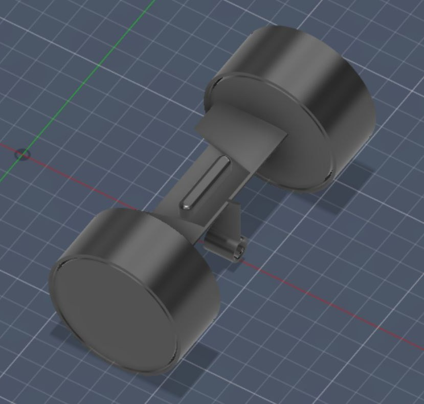

### Step 5: Why we dropped 5-axis machining

The body's sidepod cutouts and blended curves pointed to 5-axis machining, and the CAM simulation agreed. The foam did not. Tooling foam is too weak to clamp without distorting, and any fixture blocked toolpaths, so the 5-axis setup created more variation than it removed.

The rules require every body to be cut from its own official foam block, bought from the STEM Racing supplier, so a ruined block costs both money and days. We moved to a 3-axis router with a vacuum table, which holds each block evenly across its whole base, and machined every body from four sides:

1. **Roughing** with trochoidal toolpaths to keep tool load constant.
2. **Rest machining** with smaller ball-nose cutters to clear what the roughing tool could not reach.
3. **Finishing passes** with a tight stepover, leaving ridges under 0.025 mm on the aerodynamic surfaces.

For printed parts I tested PLA and PETG for form studies, SLA resin for low-friction surfaces, and carbon-fibre-filled filament for high-stress parts.

> **Why this way:** With a limited supply of regulation blocks, a reliable process mattered more than fewer setups. When every car is the same shape, a faster run means the design improved, not the machining.

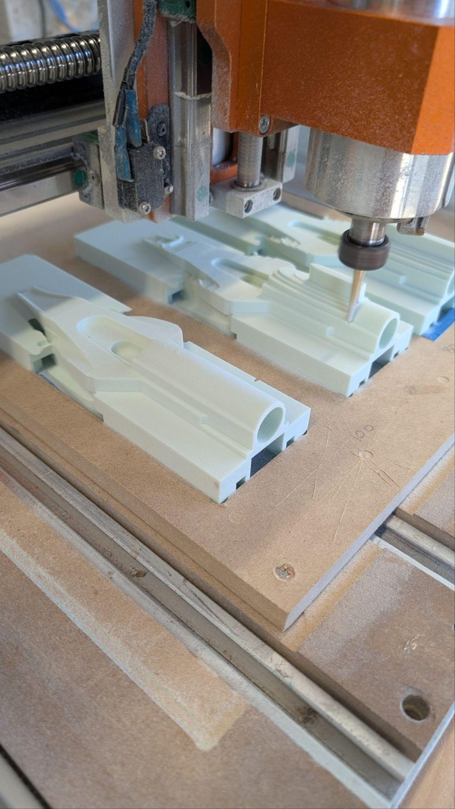
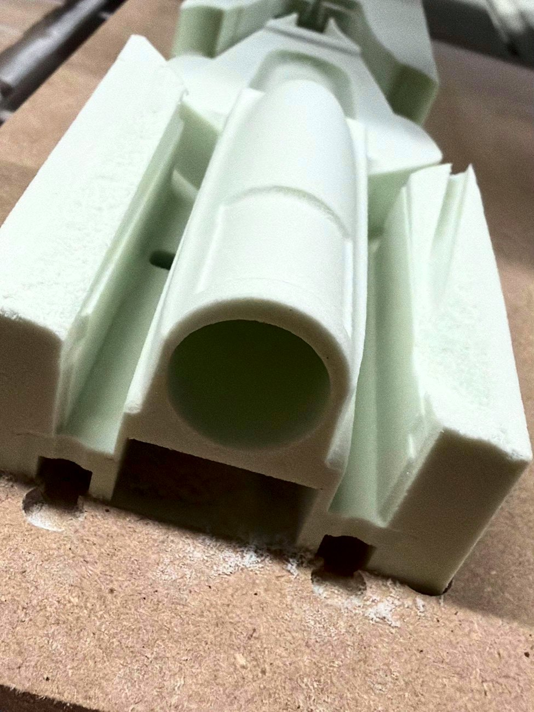
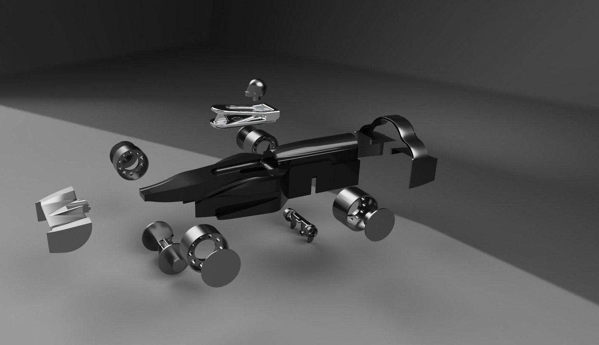

### Step 6: Running the team

We were invited two weeks before Regionals, so every other team had a head start. I ran the project so that six members and three helpers could work in parallel without waiting on each other.

- **Charter and scope.** A project charter set the deliverables up front: race cars, two 10-page portfolios, a 10-minute presentation, and a zero-waste pit display. We wrote a second charter after qualifying, when the targets changed. Anything outside that list was cut.
- **Work breakdown.** The work was split into four streams (car development, enterprise, branding, and competition) and then into tasks with an owner and acceptance criteria, such as rule compliance for the car and clarity for the portfolios.
- **Timeline.** A shared Gantt chart kept the schedule visible to everyone. Regionals and Test Day were the checkpoints where we compared progress to plan and re-ordered tasks.
- **Risk register.** Nine risks were rated by likelihood and impact, and the highest were handled first. Manufacturing delays and damage to the final car both rated 8, so we started machining early, kept buffer time, and built duplicate cars and spare parts.
- **Meetings.** Weekly meetings around a physical board, where each setback was worked through until there was a way around it.
- **Budget.** Money went first to manufacturing and testing, the areas that decide performance, with a contingency held back.

The risk planning was tested once. A rules mix-up during machining ruined a block and stopped production with no spare in stock. Our sponsor GH Precision drove out to source a replacement the same day and we were cutting again within hours.

**Sponsorship.** To fund a season of about $11,900, I built an outreach system across a list of more than 1,000 companies: cold calls, emailed proposals, and follow-ups. Every sponsor who signed on went into a stakeholder register recording the last contact, who on the team owned the relationship, and how that sponsor preferred to be reached, and we checked in with each one at milestones. It brought in $4,000 in cash and $7,600 of in-kind CNC machining and 3D printing from more than 15 sponsors, plus software and CFD mentorship.

> **Why this way:** On a short timeline the plan has to be visible. A register and a chart that everyone can see let people pick up the next task without asking, and the top-rated risks got attention while there was still time to act.

## Results / Impact

Four cars across the season: one for Regionals, a major redesign, and two matched final cars. At the 2026 National Championships we placed **4th overall**, **1st in Pit Display**, **2nd in Project Management**, and **3rd in Brand Identity**. The lighthouse at the back of the display is a model I designed and 3D printed.

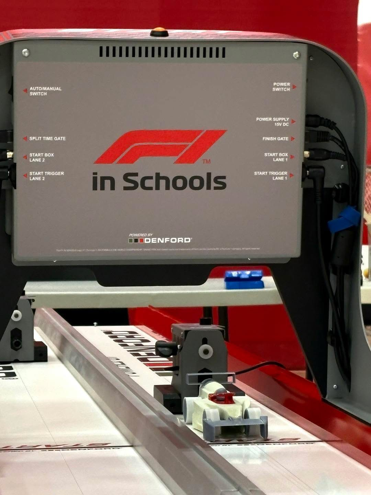
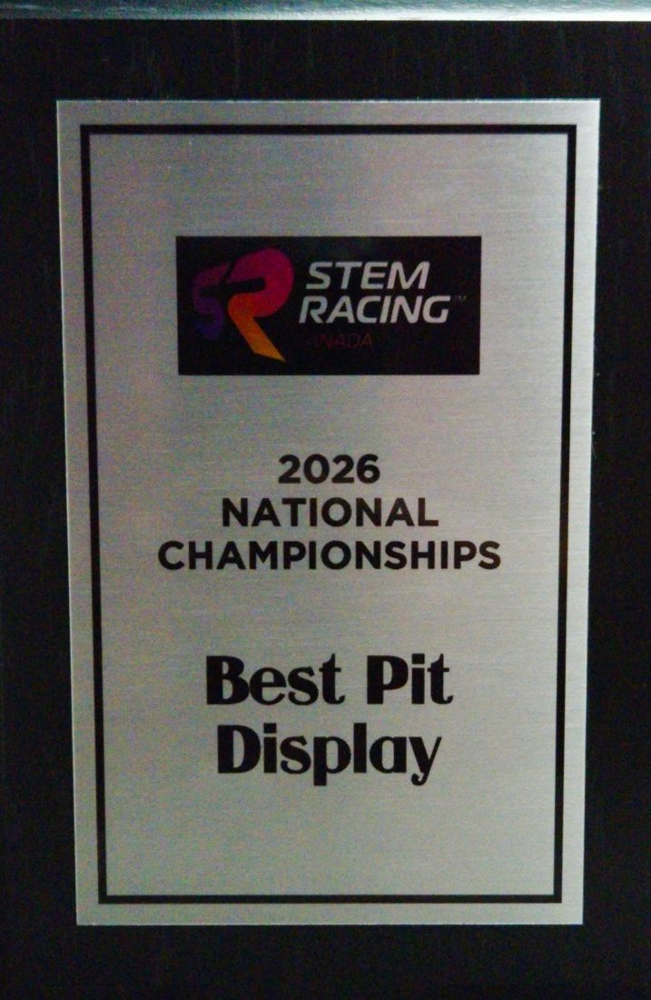
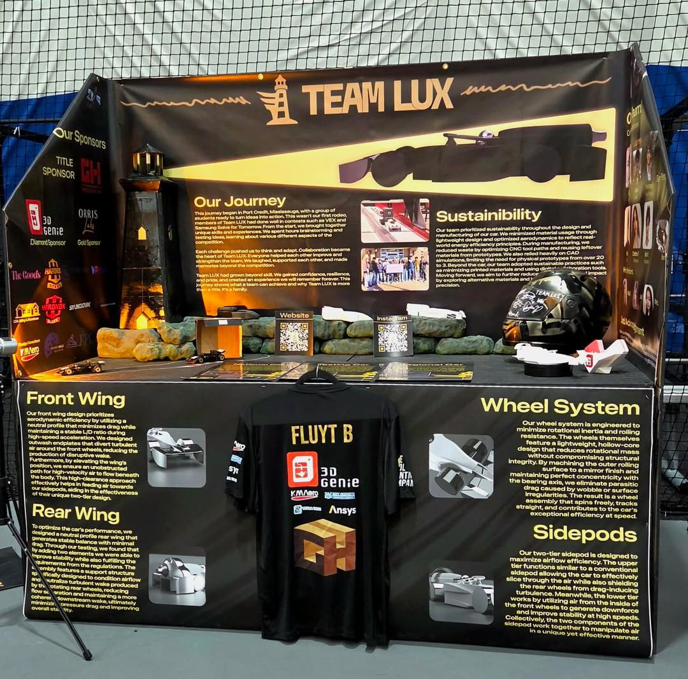

## What I learned

We finished 4th in Canada, about 10 points out of 1,000 short of qualifying for internationals. These are the things that cost us time or performance along the way.

| Issue | What happened | Next time |
| --- | --- | --- |
| First design had twice the drag | The first car was drawn quickly, before we had studied the flow. CFD later traced its 0.45 N of drag to a blunt nose, front-wheel wake pulled under the floor, and a diffuser that separated. | Run a baseline flow study on a simple car before committing to a full design. |
| Sidepod scoops that separated | The second sidepod design used aggressive scoops. Their sharp edges caused flow separation, and they were hard to machine the same way twice. | Check each new feature for machinability at the same time as its CFD result, not after. |
| Through-axle added drag | The first wheel system ran a rod through the body. The clearance channels added frontal area, and aligning the rod at the track cost setup time. | Design the wheel mounting together with the body, instead of adding it to a finished shape. |
| 5-axis machining failed on foam | CAM simulation said 5-axis was the right process. In practice the foam distorted when clamped and the fixtures blocked toolpaths, so parts varied more, not less. | Cut a test piece in the real material before planning the process around a simulation. |
| Ruined block, no spare | A rules mix-up during machining ruined a regulation block with no spare in stock, and production stopped until a sponsor sourced a replacement. | Keep at least one spare block on hand, and check each setup against the rules before cutting. |
| Very little track testing | Joining two weeks before Regionals left almost no track time, so the car was developed in CFD with few timed runs to confirm the predictions. | Schedule timed track runs for each car version so the simulation is checked against real results. |
