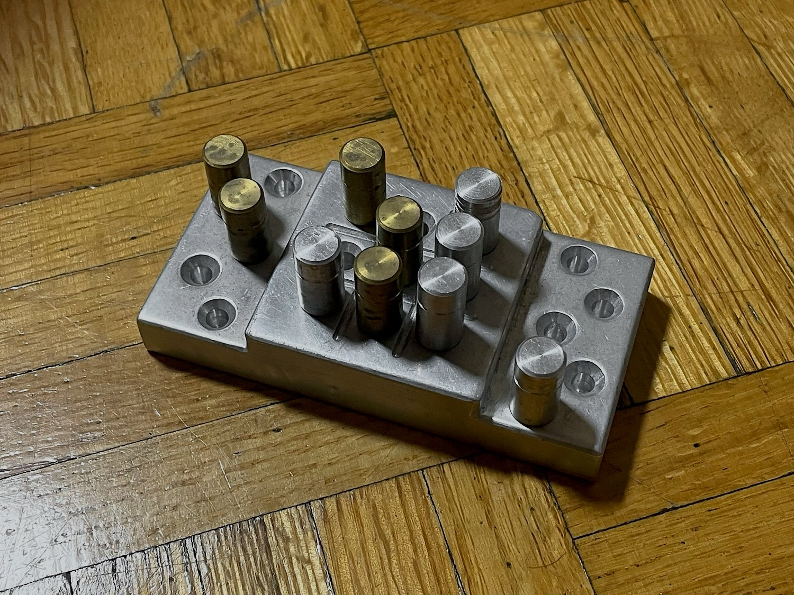
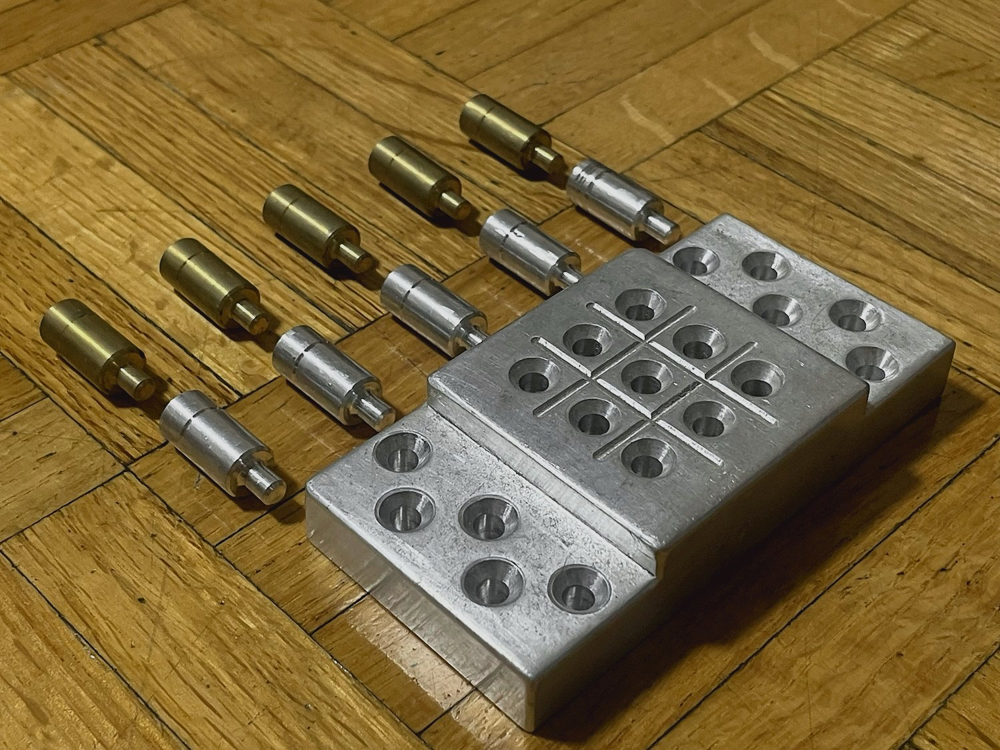
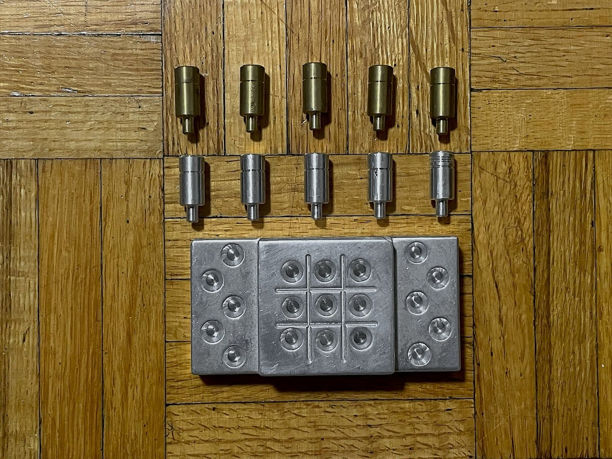

## Overview

An aluminum tic-tac-toe board with brass and aluminum pegs in place of X and O. This was my first project that needed parts to fit each other. The board is one aluminum block with a raised playing field and a lower tray at each end.

## Problem / Goal

Use two metals so the players can be told apart, and make ten pegs that fit any of nineteen holes, in any combination, without jamming.

## What I did

I designed and drew the board and pegs, then machined them: milling and drilling the board, countersinking every hole, and turning all ten pegs.

## Process

- **Pegs.** Five brass and five aluminum pegs replace X and O. Each is turned with a shoulder and a locating pin, so it drops into a hole and stands upright.
- **Holes.** All nineteen holes are countersunk. The cone guides a peg in even when it is dropped off-centre, and removes the sharp edge.
- **Clearance.** The pins are a loose sliding fit in the holes, so a peg lifts out with two fingers and never jams.
- **Trays.** Each end tray stores one player's five pegs, so the set stays together.
- **Grid.** The lines are milled grooves, so they will not wear off.

## Results / Impact

The board plays fine: every peg fits every hole and lifts out cleanly. Two cosmetic defects are visible up close, listed below.

## What I learned

> Ten pegs have to fit nineteen holes in any combination. That is only possible if every pin diameter and every hole is held to the same size, which is what a tolerance is for.

| Defect | What happened | Next time |
| --- | --- | --- |
| Notch in one corner | I turned a handwheel the wrong way during a milling pass, and the cutter took a small notch out of one corner of the board. | Check the direction of travel with the cutter clear of the part before engaging, and set table stops on finishing passes. |
| Uneven, rounded chamfers | I cut the chamfers by hand with a file, with the board held in a vise. I did not keep the file at a constant angle, so the edges came out rounded instead of flat and crisp. | Cut the chamfers on the mill with a chamfer tool so every edge has the same angle and width. |
